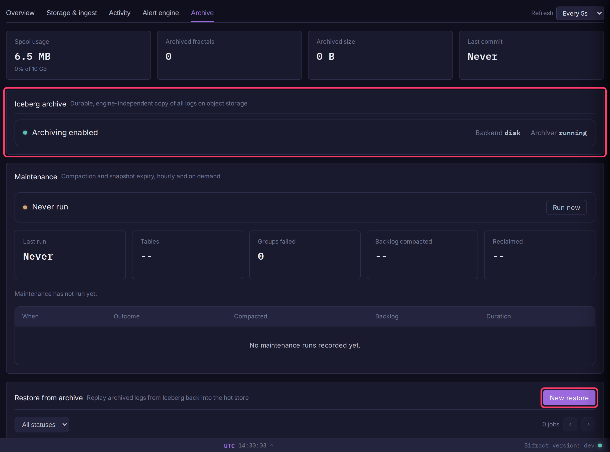
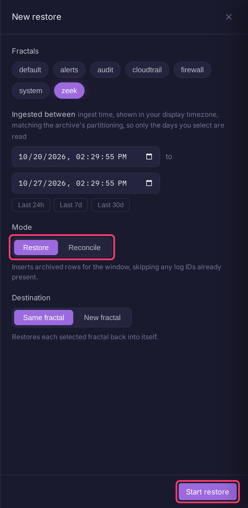

# Backup, Restore & Archive

Bifract protects two kinds of data in two ways. Use both in production.

| Data | Protected by | Where |
|------|--------------|-------|
| Configuration: users, fractals, alerts, saved searches, notebooks, the archive catalog | Encrypted PostgreSQL backup (`bifract --backup`) | Disk or S3 |
| All log data | [Iceberg archive](#iceberg-archive), a continuous copy of every log as Apache Iceberg (Parquet) | Object storage or disk |

With the archive on, ClickHouse holds each fractal's retention window and the archive holds the full history.

## PostgreSQL backups

Run these on a Docker Compose host with the containers up.

### Create a backup

```bash
bifract --backup --dir /opt/bifract
```

This writes `bifract-backup-<YYYYMMDD-HHMMSS>.bifract-backup` to `/opt/bifract/backups/`, compressed and encrypted with AES-256-GCM. List backups with `bifract --list-backups --dir /opt/bifract`.

To run it nightly, add a cron entry:

```cron
0 2 * * * /usr/local/bin/bifract --backup --dir /opt/bifract --non-interactive >> /var/log/bifract-backup.log 2>&1
```

### Restore a backup

1. Find the file name with `bifract --list-backups --dir /opt/bifract`.
2. Restore it, passing the file name only (not a path):

    ```bash
    bifract --restore --dir /opt/bifract --restore-file bifract-backup-20260101-120000.bifract-backup
    ```

3. Confirm with `y`. The current PostgreSQL database is replaced.

!!! warning "Keep the encryption key"
    The installer stores the key as `BIFRACT_BACKUP_ENCRYPTION_KEY` in `.env`. Without it, backups cannot be decrypted. Copy it somewhere safe, and into `.env` of any instance you restore to.

!!! warning "Back up PostgreSQL even with the archive on"
    The archive's catalog, which maps each fractal to its data files, lives in PostgreSQL.

### Store backups in S3

Set these in `.env` to write backups to S3-compatible storage (AWS S3, MinIO, DigitalOcean Spaces) instead of disk:

| Variable | Description |
|----------|-------------|
| `BIFRACT_S3_ENDPOINT` | Endpoint URL, e.g. `https://s3.amazonaws.com` |
| `BIFRACT_S3_BUCKET` | Bucket name. Setting it switches backups to S3 |
| `BIFRACT_S3_ACCESS_KEY` | Access key ID |
| `BIFRACT_S3_SECRET_KEY` | Secret access key |
| `BIFRACT_S3_REGION` | Region, e.g. `us-east-1` |

## Iceberg archive

The archive is off by default. When on, every ingested log is written to a durable spool on local disk before ingest is acknowledged, and the `bifract-archiver` sidecar copies it into one Iceberg table per fractal, partitioned by ingest date. If the spool cannot accept a batch, ingest returns `429` rather than lose it.

`bifract --upgrade` (or `--upgrade-k8s`) provisions the archiver and spool. Nothing is archived until you turn it on.

### Turn on the archive

1. Configure a backend (below) in `.env` (Compose) or the `bifract-secrets` Secret (Kubernetes). On Compose, apply it with `bifract --reconfigure --dir /opt/bifract`.
2. Open **Settings > Platform** and turn on **Iceberg archive** under **Archive**. It takes effect within seconds.


Setting `BIFRACT_ARCHIVE_ENABLED=true` (Kubernetes: `ARCHIVE_ENABLED`) does the same.

| Variable | Default | Description |
|----------|---------|-------------|
| `BIFRACT_ARCHIVE_BACKEND` | `disk` | `disk`, `s3`, `minio` or `azure` |
| `BIFRACT_ARCHIVE_PREFIX` | none | Path prefix inside the bucket, container or directory |
| `BIFRACT_ARCHIVE_SPOOL_MAX_BYTES` | 10 GiB | Spool size. Ingest gets `429` near it |
| `BIFRACT_ARCHIVE_ROLL_BYTES` | 128 MiB | Write a Parquet file once a fractal has buffered this much (uncompressed) |
| `BIFRACT_ARCHIVE_ROLL_INTERVAL` | `30m` | Or after this long, whichever comes first |

=== "S3 / MinIO"

    | Variable | Description |
    |----------|-------------|
    | `BIFRACT_ARCHIVE_S3_ENDPOINT` | Custom endpoint. Required for MinIO, omit for AWS |
    | `BIFRACT_ARCHIVE_S3_BUCKET` | Bucket name |
    | `BIFRACT_ARCHIVE_S3_REGION` | Region, e.g. `us-east-1` |
    | `BIFRACT_ARCHIVE_S3_ACCESS_KEY` / `BIFRACT_ARCHIVE_S3_SECRET_KEY` | Credentials |

=== "Azure Blob"

    | Variable | Description |
    |----------|-------------|
    | `BIFRACT_ARCHIVE_AZURE_ACCOUNT` | Storage account name |
    | `BIFRACT_ARCHIVE_AZURE_KEY` | Account key |
    | `BIFRACT_ARCHIVE_AZURE_CONTAINER` | Container name |
    | `BIFRACT_ARCHIVE_AZURE_ENDPOINT` | Optional custom endpoint, e.g. Azurite |

=== "Local disk"

    | Variable | Description |
    |----------|-------------|
    | `BIFRACT_ARCHIVE_DISK_PATH` | Directory for the Iceberg warehouse. Single node or testing only |

!!! note "Use object storage on more than one node"
    The `disk` backend is local to one machine and ClickHouse cannot read it back, so restore does not work with it. On Kubernetes or any multi-node install, use `s3`, `minio` or `azure`.

To keep archived data for a limited time, set **Delete archived data after** on each fractal's **Fractal settings > Lifecycle** tab. Protect the bucket itself from deletion with object storage versioning and object lock.

### Check archive status

Open **System** in the sidebar's **Admin** section, then the **Archive** tab. It shows whether the archive is on, the backend, spool usage, archived fractals and size, the last commit, and maintenance runs.



### Restore from the archive

Restore copies archived logs back into ClickHouse, for example after losing ClickHouse data or to bring back logs past retention.

1. Open **System > Archive** and click **New restore**.
2. Select one or more **Fractals**.
3. Set **Ingested between**, or click **Last 24h**, **Last 7d** or **Last 30d**. The window is ingest time, not event time.
4. Pick a **Mode**:
    - **Restore** inserts every archived log in the window, skipping logs already present.
    - **Reconcile** compares counts first and restores only what ClickHouse is missing.
5. Pick a **Destination**: **Same fractal**, or **New fractal** (one source fractal only) to restore into a new fractal with no retention.
6. Click **Start restore**, then **Confirm restore**.



Each fractal becomes a job with live progress. Jobs run one ingest day at a time, so you can **Cancel** a job and later **Resume** it from the first unfinished day. If the window is older than the fractal's retention, Bifract warns that retention will delete the data again within the hour; raise retention first, or click **Restore anyway**.

!!! warning "Restore is heavy"
    Restoring N days costs about what ingesting N days cost, and can trigger ingest backpressure. See [Recovery time](#recovery-time) before restoring months.

??? note "Restore from the command line"
    For scripting, or when the archiver is not running. Fractal IDs are UUIDs; `--to` is exclusive.

    ```bash
    # Restore (dedups on log_id). --target <fractal-id> restores into another existing fractal.
    docker exec bifract-archiver /bifract-archiver restore --fractal <fractal-id> --from 2026-01-01 --to 2026-02-01

    # Restore only what ClickHouse is missing
    docker exec bifract-archiver /bifract-archiver reconcile --fractal <fractal-id> --from 2026-01-01 --to 2026-02-01
    ```

    Each finished day logs a resume point. To continue an interrupted run, rerun it with `--from` set to that point.

### Maintenance

The `bifract-archiver-maintain` service (Kubernetes: the `bifract-archive-maintain` Deployment) compacts small Parquet files and expires old snapshots. It is required at high volume. Run a pass on demand with **Run now** on **System > Archive**.

| Variable | Default | Description |
|----------|---------|-------------|
| `BIFRACT_ARCHIVE_MAINTAIN_INTERVAL` | `1h` | How often a pass runs |
| `BIFRACT_ARCHIVE_MAINTAIN_LOOKBACK` | `72h` | How far back a routine pass compacts |
| `BIFRACT_ARCHIVE_DEEP_COMPACTION_INTERVAL` | `24h` | How often a pass covers the whole table. `0` disables it |

### Start the archive over

To point the archive at fresh storage:

1. Turn off **Iceberg archive** in **Settings > Platform**.
2. In **Settings > Danger zone**, click **Clear catalog** (and **Clear spool** to discard logs not yet archived).
3. Empty the old bucket or container yourself. Clearing the catalog does not delete data files.

## Recovery time

The archive keeps data safe, but getting it back into ClickHouse is slow. Restore skips parsing but re-runs every materialized view and merge, so **restoring N days costs about what ingesting N days cost**. More shards help but do not remove that cost.

At Large (500 GB to 2 TB per day) and X-Large sizes:

- Restoring 90 days takes days to weeks.
- Shard disks sized for the retention window may not fit the full history.
- Logs older than 7 days come back without `raw_log`. Searches are unaffected, since they read the normalized fields.

Plan recovery in two steps:

1. Restore the recent window (days, not months) so search, alerts and dashboards work again.
2. Search older history in place with the fractal's **Recall** page, which reads the archive directly with no restore.

## Rolling back after a ClickHouse upgrade

ClickHouse cannot be downgraded. If an older ClickHouse starts on data a newer one wrote, it moves the unreadable parts to `detached/` with a `broken-on-start_` prefix, and those logs vanish from search without an error. Nothing is deleted.

To get them back:

1. Run the newer ClickHouse again by re-running the newer `bifract --upgrade` or `--upgrade-k8s`.
2. Save this as `reattach.sh`:

    ```sh
    clickhouse-client --password "$CLICKHOUSE_PASSWORD" -q "SELECT database, table, name, path FROM system.detached_parts WHERE reason = 'broken-on-start' FORMAT TSV" |
    while IFS="$(printf '\t')" read -r db tbl name path; do
      part="${name#broken-on-start_}"
      mv "${path%/}" "$(dirname "${path%/}")/$part"
      clickhouse-client --password "$CLICKHOUSE_PASSWORD" -q "ALTER TABLE \`$db\`.\`$tbl\` ATTACH PART '$part'"
    done
    ```

3. Run it inside ClickHouse (on Kubernetes, once per shard pod):

    ```bash
    # Docker Compose
    docker exec -i bifract-clickhouse sh < reattach.sh

    # Kubernetes
    kubectl -n bifract exec -i bifract-ch-clickhouse-0-0-0 -- sh < reattach.sh
    ```

4. Check that `SELECT count() FROM system.detached_parts` returns 0.
