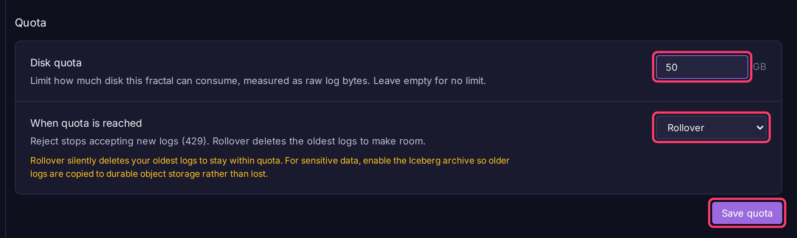

# Disk Quotas

A disk quota caps how much storage one fractal can use. When it is full, Bifract either rejects new logs or deletes the oldest ones to make room.

## Set a quota

Tenant admins only.

1. Open the fractal from **Fractals**, click **Fractal settings** in the sidebar, then the **Lifecycle** tab.
2. Under **Quota**, enter a **Disk quota** in GB. Leave it empty for no limit.
3. Pick **When quota is reached**: **Reject new logs** or **Rollover**.
4. Click **Save quota**.

Usage is estimated from ClickHouse part metadata, so checking it never scans logs.

## Reject new logs

The default. Once estimated usage plus an incoming batch would exceed the quota, the batch is refused with `429 Too Many Requests` and `Retry-After: 30`. Existing logs are kept. Shippers should back off longer than for normal queue pressure, or send elsewhere.

## Rollover

New logs are always accepted. Once a minute, a background sweep checks each rollover fractal and, if it is over quota, deletes its oldest ingest days until usage is back to 80% of the quota.

- It drops whole days (one partition per fractal per ingest day), so a fractal with a few large days can end up well below 80%.
- Oldest means earliest ingested, not earliest event timestamp.
- The newest day is never dropped.

!!! warning "Rollover deletes data"
    Rollover silently deletes your oldest logs. For data you must keep, turn on the [Iceberg archive](backup-restore.md#iceberg-archive) so a copy survives.
