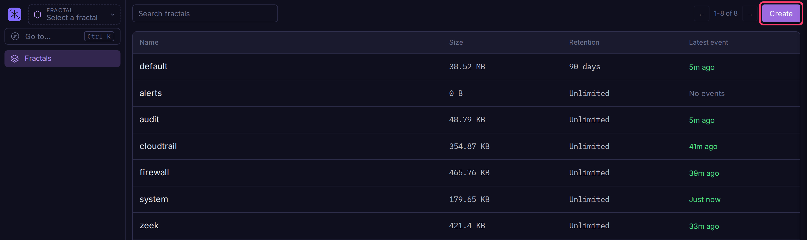
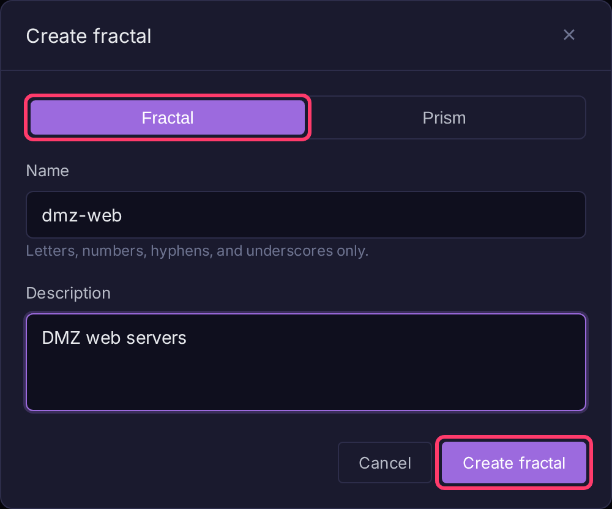
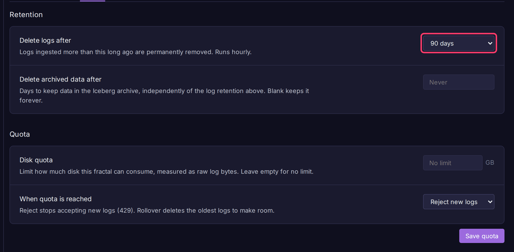

# Fractals

A fractal is an isolated log container with its own logs, ingest tokens, API keys, alerts, comments and permissions. Create one per team, environment or data source you want to keep apart. To search several at once, group them in a [prism](prisms.md).

## Create a fractal

Tenant admins only.

1. Click **Fractals** at the top of the sidebar.
2. Click **Create**.
3. Leave **Fractal** selected, enter a **Name** (letters, numbers, hyphens and underscores, starting with a letter) and an optional **Description**.
4. Click **Create fractal**.

The new fractal gets a default ingest token on its **Ingest** page.

## Fractal settings

Open a fractal from **Fractals**, then click **Fractal settings** in the sidebar. Changes on every tab other than **Overview** need a tenant admin.

| Tab | Contents |
|-----|----------|
| **Overview** | Name, description (**Edit**), creator, log count, size, earliest and latest log |
| **Access** | **Permissions** (see [Grant access](users-and-roles.md#grant-access-to-a-fractal-or-prism)) and [API keys](ingest-tokens.md) |
| **Lifecycle** | Retention, archive retention and [disk quota](disk-quotas.md) |
| **Danger zone** | **Clear logs** and **Delete fractal** |

## Set retention

1. Open **Fractal settings > Lifecycle**.
2. Pick **Delete logs after**: Never, or 7, 14, 30, 90, 180 or 365 days. It saves on change.
3. With the [Iceberg archive](backup-restore.md#iceberg-archive) on, optionally set **Delete archived data after** in days. Blank keeps archived data forever.

Retention runs hourly and removes logs by ingest time.

## Clear logs or delete a fractal

!!! warning "Irreversible"
    Both actions permanently delete log data. Each asks you to type the fractal name to confirm.

- **Clear logs** (**Fractal settings > Danger zone**) deletes every log and its comments. The fractal, alerts, keys and settings stay.
- **Delete fractal** (tenant admins) deletes the fractal with its logs, alerts, comments and permissions. The default and system fractals cannot be deleted.
