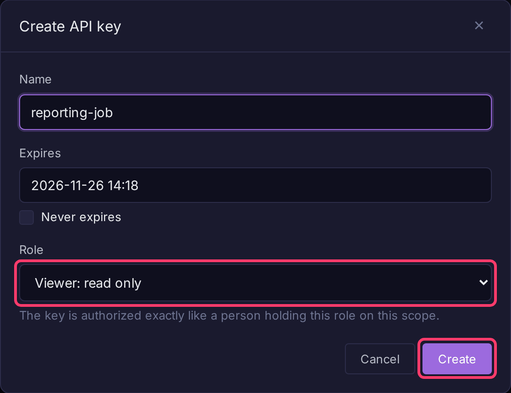
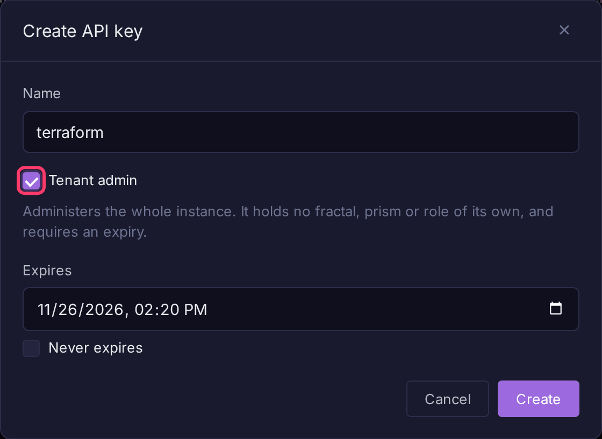

# API Keys

Bifract has two kinds of credentials for programs:

| Kind | Prefix | Used for | Managed in |
|------|--------|----------|------------|
| Ingest token | `bifract_ingest_` | Sending logs to one fractal | The fractal's **Ingest** page |
| API key | `bifract_<scope>_` | The query, comment, alert, notebook and dashboard APIs, the [MCP server](../features/mcp-server.md) and [exports](exporting-logs.md) | **Fractal settings > Access** (or **Prism settings > Access**), and **Settings > API keys** |

Every fractal gets a default ingest token when it is created. To create more, see [Get an ingest token](../ingestion/overview.md#get-an-ingest-token). The rest of this page covers API keys; for how to send them, see [Authentication](../api/authentication.md).

## Create an API key for a fractal or prism

Tenant admins only.

1. Open the fractal or prism, click **Fractal settings** (or **Prism settings**) in the sidebar, then the **Access** tab.
2. Under **API keys**, click **Create API key**.
3. Enter a **Name**, set **Expires** (defaults to 30 days) or tick **Never expires**, and pick a **Role**.
4. Click **Create**.
5. Click **Copy**. The key is shown only once.

In the key list, **Deactivate** turns a key off without deleting it (**Activate** turns it back on) and **Delete** revokes it permanently.

## Roles

A key holds one role on the fractal or prism it was issued for, authorized exactly like a person with that role. Issue the lowest role that does the job.

| Role | Can do |
|------|--------|
| `viewer` | Read logs, comments, alerts, notebooks and dashboards |
| `analyst` | Viewer, plus create and edit them |
| `admin` | Analyst, plus alert policies and change review, and [export logs](exporting-logs.md) |

## Tenant admin keys

A tenant admin key administers the whole instance. It belongs to no fractal or prism, uses the prefix `bifract_admin_`, and must have an expiry.

1. Open **Settings**, then the **API keys** tab.
2. Click **Create API key**.
3. Enter a **Name**, tick **Tenant admin**, and set **Expires**.
4. Click **Create** and copy the key.

Requests made with a tenant admin key name the fractal or prism they act on in the `X-Bifract-Scope` header. A key is either scoped or tenant admin, and cannot be converted later.

The **API keys** tab also lists every scoped key in the instance and can create one for any fractal or prism (leave **Tenant admin** unticked and pick a **Scope** and **Role**). Use **Tenant admin keys only** to filter the list, and **Revoke** in a row's **⋮** menu to disable a key.

!!! warning
    API keys skip two-factor authentication. Give tenant admin keys a short expiry and revoke them when done.
