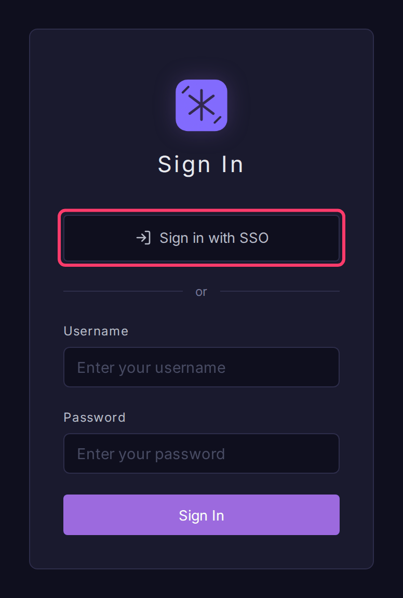

# OIDC / SSO

Bifract supports single sign-on with any OpenID Connect provider (Entra ID, Okta, Keycloak, Google Workspace, Auth0). It is off by default, is configured with environment variables, and works alongside local passwords.

## Set up SSO

1. In your identity provider, register an application:
    - **Redirect URI**: `https://bifract.example.com/api/v1/auth/oidc/callback`
    - **Scopes**: `openid`, `profile`, `email`
    - **Grant type**: Authorization Code
2. Add the issuer, client ID and secret to `.env` in the install directory (Kubernetes: the `bifract-secrets` Secret, see [Post-deploy configuration](../getting-started/kubernetes.md#post-deploy-configuration)):

    ```bash
    BIFRACT_OIDC_ISSUER_URL=https://login.microsoftonline.com/<tenant-id>/v2.0
    BIFRACT_OIDC_CLIENT_ID=<client-id>
    BIFRACT_OIDC_CLIENT_SECRET=<client-secret>
    ```

3. Apply it: `bifract --reconfigure --dir /opt/bifract`.
4. Open the login page. It now shows **Sign in with SSO**.



On first SSO sign in, Bifract creates the account with the role in `BIFRACT_OIDC_DEFAULT_ROLE`. SSO accounts cannot sign in with a password and are exempt from Bifract's two-factor requirement. Disabling an SSO user in **Settings > Users** blocks their SSO sign in too.

## Restrict email domains

```bash
BIFRACT_OIDC_ALLOWED_DOMAINS=example.com,corp.example.com
```

Sign ins from other domains are refused. With an allowlist set, Bifract also refuses ID tokens that carry `email_verified: false`. Providers that omit the claim (Entra ID) are checked on domain only.

## Environment variables

SSO is enabled when both the issuer URL and client ID are set.

| Variable | Default | Description |
|----------|---------|-------------|
| `BIFRACT_OIDC_ISSUER_URL` | unset | Issuer discovery URL |
| `BIFRACT_OIDC_CLIENT_ID` | unset | OAuth2 client ID |
| `BIFRACT_OIDC_CLIENT_SECRET` | empty | OAuth2 client secret |
| `BIFRACT_OIDC_REDIRECT_URL` | derived | Callback URL. Defaults to `BIFRACT_BASE_URL` (or `https://` + `BIFRACT_DOMAIN`) plus `/api/v1/auth/oidc/callback` |
| `BIFRACT_OIDC_SCOPES` | `openid,profile,email` | Comma-separated scopes |
| `BIFRACT_OIDC_DEFAULT_ROLE` | `user` | Tenant role for new SSO users: `user` or `admin` |
| `BIFRACT_OIDC_ALLOWED_DOMAINS` | all | Comma-separated email domain allowlist |
| `BIFRACT_OIDC_BUTTON_TEXT` | `Sign in with SSO` | Login button text |

## Provider issuer URLs

| Provider | `BIFRACT_OIDC_ISSUER_URL` |
|----------|---------------------------|
| Entra ID | `https://login.microsoftonline.com/<tenant-id>/v2.0` |
| Google Workspace | `https://accounts.google.com` (also set `BIFRACT_OIDC_ALLOWED_DOMAINS`, since any Google account can sign in) |
| Keycloak | `https://keycloak.example.com/realms/<realm>` |
