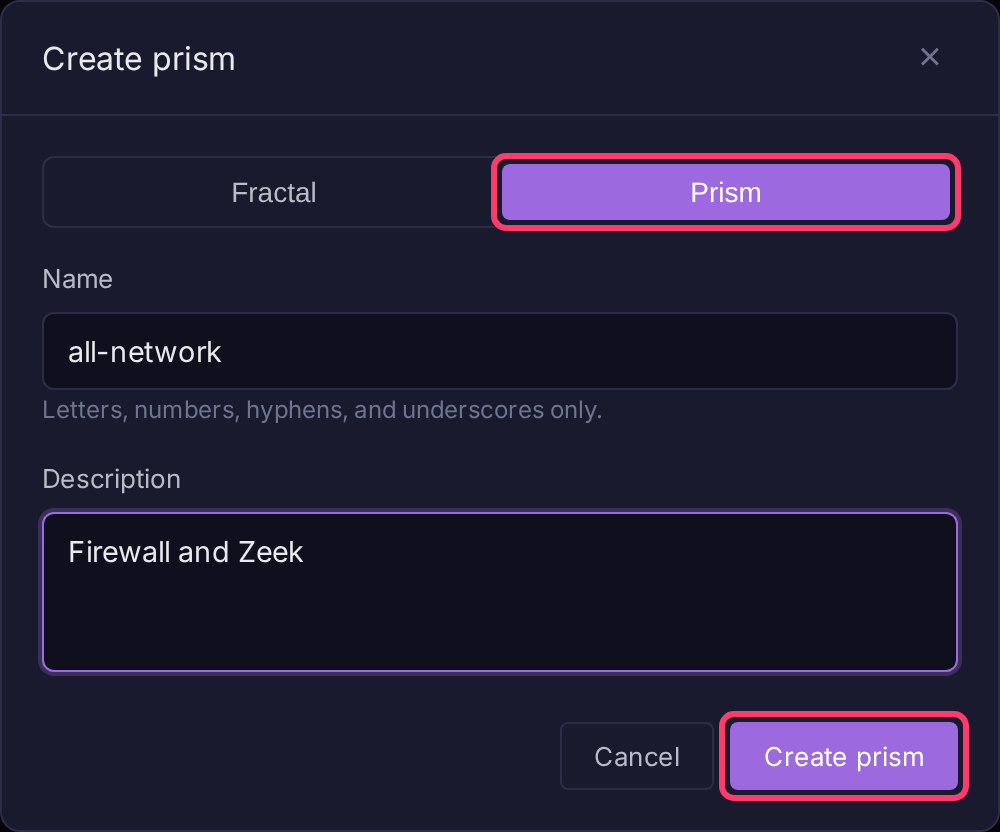
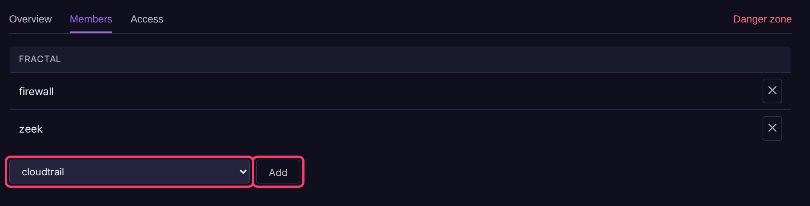

# Prisms

A prism is a view across several fractals. It stores no data; searches, dashboards, notebooks and alerts on a prism run over all its member fractals together. Use one to search multiple teams or environments at once, or to attach [alert feeds](../alerting/alert-feeds.md) that should follow your fractal layout as it grows.

## Create a prism

Tenant admins only.

1. Click **Fractals** at the top of the sidebar.
2. Click **Create**, then choose **Prism**.
3. Enter a **Name** and optional **Description**, then click **Create prism**.

## Add or remove member fractals

1. Open the prism from **Fractals**.
2. Click **Prism settings** in the sidebar, then the **Members** tab.
3. Pick a fractal in **Select a fractal to add** and click **Add**.

To remove a member, click its **✕** button. Changes apply immediately for everyone.

## Prism settings

| Tab | Contents |
|-----|----------|
| **Overview** | Name, description (**Edit**) and member list |
| **Members** | Add and remove member fractals |
| **Access** | Permissions and API keys for the prism, separate from those on its members |
| **Danger zone** | **Delete prism**. Member fractals and their data are not affected |
