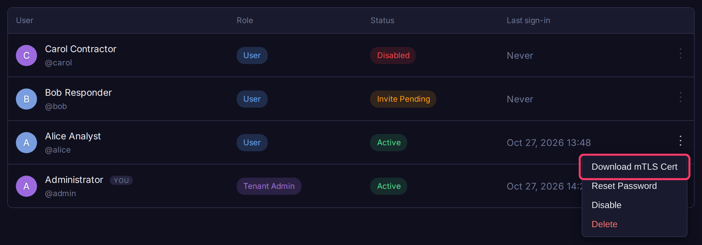
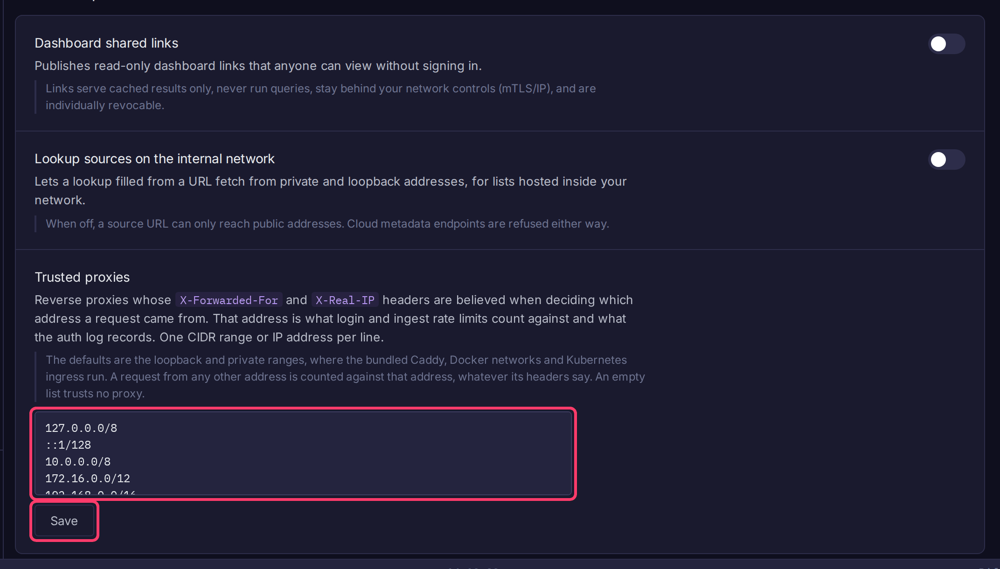

# Reverse Proxy (Caddy)

In a Docker Compose install, all traffic enters through the bundled Caddy. This page covers its TLS certificates, IP and mTLS access control, and how Bifract finds the real client address behind a proxy.

| Port | Serves |
|------|--------|
| 443 | UI and API |
| 8443 | Ingest endpoints only (`/api/v1/ingest*`, `/_bulk`, `/v1/logs`) |
| 80 | Let's Encrypt challenges and the HTTPS redirect (Let's Encrypt and custom modes) |

PostgreSQL, ClickHouse and LiteLLM are reachable only inside the Docker network. Caddy's access logs are shipped to the **system** fractal.

## TLS certificates

Pick the mode in `bifract --install`. It is stored as `BIFRACT_SSL_MODE` in `.env`.

| Mode | Use when |
|------|----------|
| `letsencrypt` | The server is reachable from the internet on ports 80 and 443 with a public DNS name. Caddy obtains and renews the certificate |
| `self-signed` | Internal or air-gapped installs. The installer generates a certificate for your IP or hostname in `caddy/certs/`. Browsers show a warning |
| `custom` | You have a certificate from your own or a commercial CA. The installer copies the files you name into `caddy/certs/` |

To renew a custom certificate, replace `caddy/certs/cert.pem` and `caddy/certs/key.pem`, then run `docker restart bifract-caddy`. Also update the files at `BIFRACT_CERT_PATH` and `BIFRACT_KEY_PATH`, since `bifract --upgrade` copies them in again.

!!! note
    The Caddyfile is generated from `.env`. Do not edit `caddy/Caddyfile` by hand; `--reconfigure` and `--upgrade` overwrite it.

## Access control

Caddy rejects disallowed clients before they reach Bifract.

| Mode | UI and API | Ingest (port 8443) |
|------|------------|--------------------|
| `restrict-app` | Allowed IPs only | Anyone |
| `restrict-all` | Allowed IPs only | Allowed IPs only |
| `mtls-app` | Client certificate required | No certificate needed |
| `all` | Anyone (not recommended) | Anyone |

### Change the mode

1. Edit `.env` in the install directory:

    ```bash
    BIFRACT_IP_ACCESS=restrict-app
    # IPs or CIDR ranges, used by restrict-app and restrict-all
    BIFRACT_ALLOWED_IPS=10.0.0.0/8,192.168.1.0/24,203.0.113.5
    ```

2. Apply it:

    ```bash
    bifract --reconfigure --dir /opt/bifract
    ```

### mTLS client certificates

When `mtls-app` is chosen, the installer creates a client CA (`caddy/client-ca/ca.pem`) and an initial `caddy/client-ca/admin.p12`. Switching to `mtls-app` later with `--reconfigure` creates the CA.

To issue a certificate for a user:

1. Open **Settings > Users**.
2. Open the user's **⋮** menu and choose **Download mTLS Cert**.
3. Enter a password to protect the file. The `.p12` downloads.



Or from the CLI:

```bash
bifract --gen-client-cert --name alice --password '<p12-password>' --dir /opt/bifract
```

Import the `.p12` into the user's browser or OS keychain. Certificates are valid for 1 year.

## Trusted proxies

Bifract applies per-address sign-in and ingest rate limits and logs the client address, so it needs the real address behind a proxy. For a request from a trusted proxy, it reads `X-Forwarded-For` from the right and takes the first address that is not a trusted proxy, falling back to `X-Real-IP`. For any other request it ignores those headers and uses the connecting address.

Edit the list in **Settings > Security > Trusted proxies**, one IP or CIDR range per line, and click **Save**. It applies to the next request; a separate ingest tier picks it up on restart.



The default trusts loopback and the private ranges (`10.0.0.0/8`, `172.16.0.0/12`, `192.168.0.0/16`, `fc00::/7`, `fe80::/10`), which covers the bundled Caddy, Docker networks and Kubernetes ingress. Change it when:

- A proxy or load balancer with a public address sits in front of Bifract: add its address.
- Internal clients reach Bifract directly, or through a proxy that appends to `X-Forwarded-For` (such as an AWS ALB): replace the defaults with only your proxy's address. Otherwise an internal client can set its own address with a header.
- Nothing proxies Bifract: clear the list.
