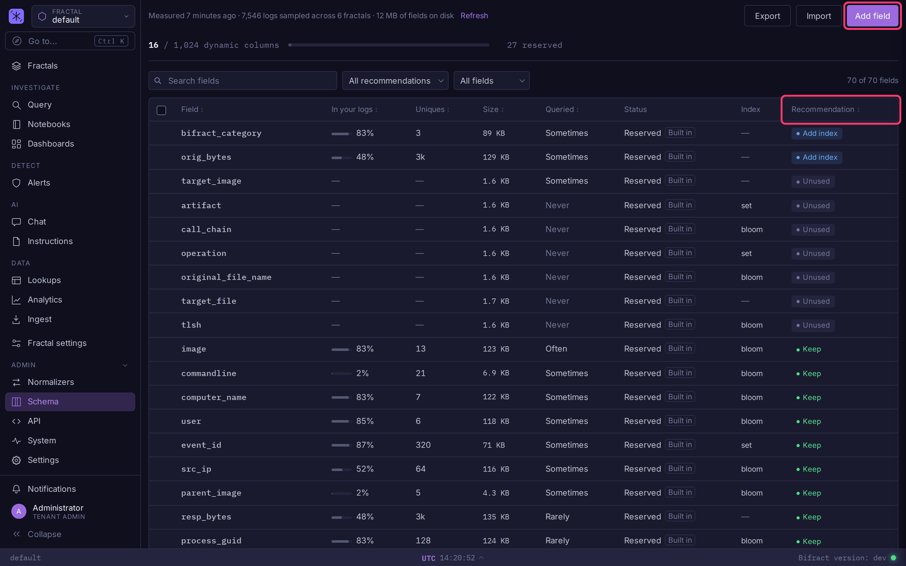
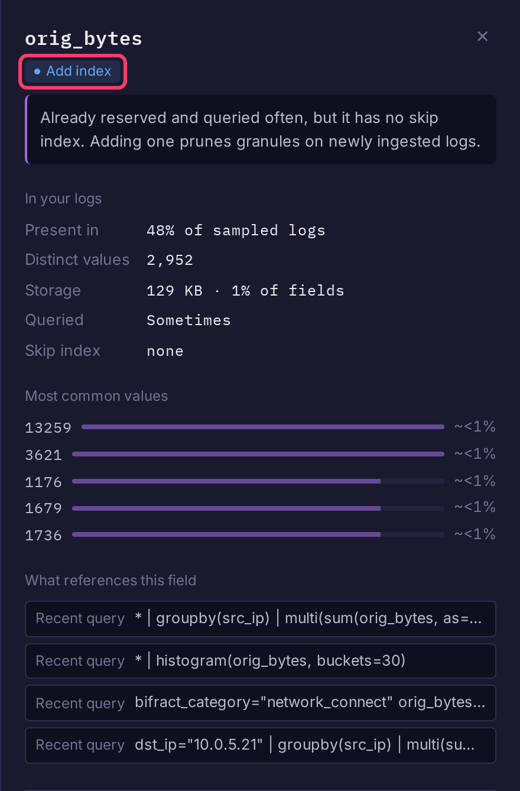

# Schema Fields

The **Schema** page shows every field in your logs and lets tenant admins reserve the ones queries use most. A reserved field gets its own ClickHouse column, and optionally a skip index, so filters on it read far less data. It applies to all fractals.

Open it from **Schema** in the sidebar's **Admin** section.

## Read the table

A background sweep samples your logs and measures each field. The line at the top says when it last ran; **Refresh** runs it now.

| Column | Meaning |
|--------|---------|
| **In your logs** | Share of sampled logs that have the field |
| **Uniques** | Distinct values |
| **Size** | Bytes on disk |
| **Queried** | How often alerts, dashboards, saved queries and recent searches use it: Never, Rarely, Sometimes, Often |
| **Status** | **Reserved** (with **Built in** for project defaults), **Not reserved** or **Ignored** |
| **Index** | Skip index type, **Applying** while it is added, or **Index failed** |
| **Recommendation** | **Reserve now**, **Reserve**, **Add index**, **Keep**, **Unused**, or a dash for no action |

The capacity strip above the table counts dynamic columns against the limit of 1,024. Past it, new fields lose their own column and every query on them scans all rows; those show **Reserve now**.

Click a row to see its top values, what references it, and why it got its recommendation.

## Reserve a field

1. Optionally change the **All recommendations** filter to **Reserve** to list the candidates.
2. Click the field's row.
3. Click **Reserve field**. Bifract applies the recommended skip index.

To reserve several at once, tick their checkboxes and click **Reserve selected**.

The column applies to logs you already have. A skip index applies to newly ingested logs only.

For a field not in your logs yet, click **Add field**, enter the **Field name** (letters, digits and underscores, starting with a letter or underscore), pick a **Skip index**, and click **Add field**:

| Skip index | Use for |
|------------|---------|
| **No index** | Default. Fields you read but rarely filter on |
| **Set** | Under a few hundred distinct values (status, severity, region) |
| **Bloom filter** | Many distinct values (IDs, hashes, hostnames) |

Every index costs work on each ingested row, so leave it off unless you filter on the field.

## Ignore or remove a field

- **Ignore** (in the row's drawer) stops recommending a field. Set the status filter to **Ignored** and click **Restore** to undo.
- **Remove** (on a reserved custom field) un-reserves it. Its ClickHouse column and index stay until a schema reset.

## Export and import

**Export** downloads your custom fields as `schema-fields.yaml`. **Import** replaces all custom fields with the file's contents. Log data is unaffected.

## Reset the schema

!!! danger "Deletes all log data"
    **Settings > Danger zone > Reset schema** deletes every log in every fractal and rebuilds the schema from the built-in fields plus your current custom fields. It is the only way to drop columns that are no longer reserved. You must type `DELETE ALL LOG DATA` to confirm.

    With the [Iceberg archive](backup-restore.md#iceberg-archive) on, the archive is untouched and logs can be restored from it afterwards. Without it, a reset cannot be undone.
