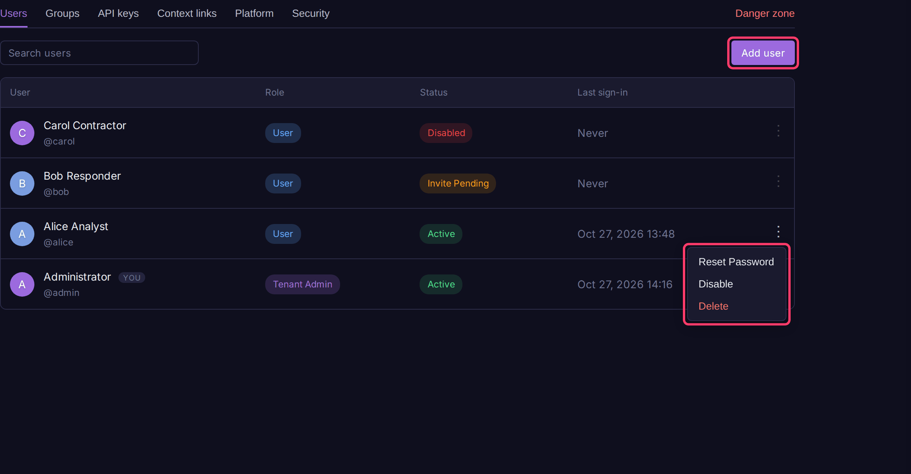
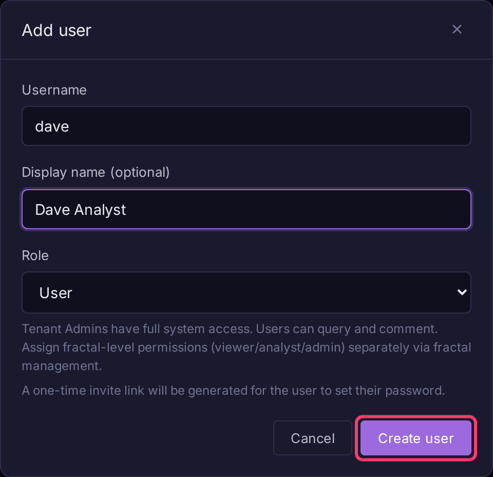
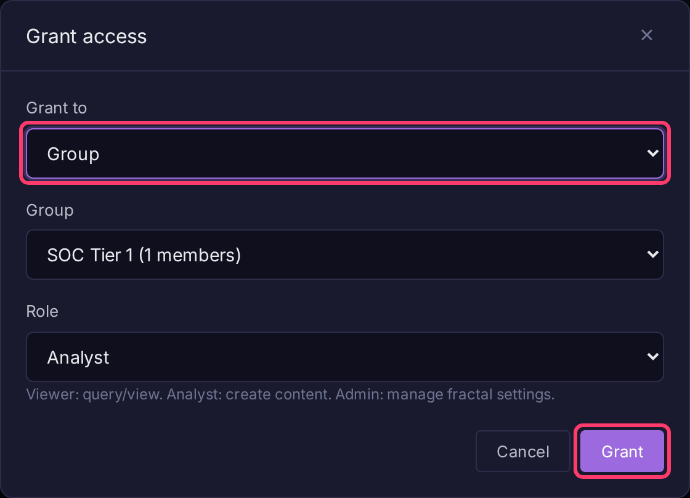

# Users & Roles

Tenant admins add users, decide who is a tenant admin, and grant per-fractal roles directly or through groups. Everything here lives under **Settings** in the sidebar's **Admin** section.

## Roles

Every user has one tenant role:

| Tenant role | Shown as | Can do |
|-------------|----------|--------|
| `admin` | Tenant Admin | Everything: users, fractals, prisms, schema, settings, all data |
| `user` | User | Only what their fractal and prism roles allow |

A `user` also needs a role on each fractal or prism they should see:

| Fractal role | Can do |
|--------------|--------|
| `viewer` | Search logs and read comments, notebooks, dashboards and alerts |
| `analyst` | Viewer, plus create and edit comments, notebooks, dashboards and alerts |
| `admin` | Analyst, plus alert policies and change review, deleting others' comments, and [exports](exporting-logs.md) |

Tenant admins have full access to every fractal regardless of grants. Fractal settings (access, API keys, ingest tokens, retention, quotas, clearing logs) are tenant admin only. A user's effective role is the strongest one granted directly or through any group.

## Add a user

1. Open **Settings** and stay on the **Users** tab.
2. Click **Add user**.
3. Enter a **Username**, an optional **Display name**, and pick a **Role** (**User** or **Tenant Admin**).
4. Click **Create user**.
5. Click **Copy** and send the invite link to the user. It expires in 7 days.

The user opens the link and chooses their own password. Admins never set passwords. To give the new user data access, [grant them a fractal role](#grant-access-to-a-fractal-or-prism).

## Edit or manage a user

Click a user's name to open **Edit user**, where you can change **Display name** and **Role**. You cannot change your own role.

Other actions are in the row's **⋮** menu:

| Action | What it does |
|--------|--------------|
| **Resend Invite** | Issues a new invite link for a user who has not signed in yet |
| **Reset Password** | Clears the password and gives you a new invite link to send. Until the user opens it, sign in only says the password is wrong |
| **Disable** / **Enable** | Signs the user out and blocks sign in, keeping their comments, notebooks and dashboards |
| **Reset Two-Factor** | Clears their authenticator after they lose both device and recovery codes; they enroll again at next sign in |
| **Download mTLS Cert** | Only in `mtls-app` mode. Asks for a password, then downloads a `.p12` client certificate. See [mTLS client certificates](reverse-proxy.md#mtls-client-certificates) |
| **Delete** | Removes the account. You cannot delete yourself |

OIDC users have no password and no invite; see [OIDC / SSO](oidc-sso.md).

## Grant access to a fractal or prism

1. Open the fractal (or prism) from **Fractals**.
2. Click **Fractal settings** (or **Prism settings**) in the sidebar, then the **Access** tab.
3. Under **Permissions**, click **Grant access**.
4. Set **Grant to** (**User** or **Group**), pick the user or group, and choose a **Role**.
5. Click **Grant**.

Tenant admins only. Use **Revoke** on a row to remove a grant.

## Groups

Groups grant the same role to several users at once.

1. Open **Settings**, then the **Groups** tab.
2. Click **Create group**, enter a **Group name** and optional description, and click **Create group**.
3. Click the group, then **+ Add members** and pick users.
4. Grant the group a role on a fractal or prism as in [Grant access](#grant-access-to-a-fractal-or-prism), with **Grant to** set to **Group**.

## Two-factor authentication

Bifract uses standard TOTP (Google Authenticator, 1Password, Authy, Bitwarden and similar).

To enroll yourself:

1. Click your name at the bottom of the sidebar and choose **Two-Factor Authentication**.
2. Enter your current password, click **Set up authenticator**, scan the QR code, enter a code and click **Confirm**. Confirming signs out your other sessions.
3. Save the ten single-use recovery codes, then click **I have saved these codes**.

Each recovery code replaces an authenticator code once. **New recovery codes** in the same dialog replaces the whole set.

To require it for everyone, open **Settings > Security** and turn on **Require two-factor authentication**. Users enroll at their next sign in.

- SSO accounts are exempt; their identity provider handles MFA.
- [API keys](ingest-tokens.md) never ask for a code, so scope them narrowly.

!!! note "Needs a password pepper"
    Enrollment secrets are encrypted with a key derived from `BIFRACT_PASSWORD_PEPPER`, which the installer generates. Without a pepper, two-factor is unavailable and the setting is disabled. Changing the pepper invalidates all enrollments and every password, so never rotate it.

## Failed sign-in limits

Failed password sign-ins are counted in a 15 minute window:

| Counted per | Limit | Then |
|-------------|-------|------|
| Account | 5 wrong passwords | Sign in to that account is refused for 5 minutes, except from addresses it signed in from in the last 30 days |
| Client address | 20 failures, any usernames | Sign in from that address is refused for 15 minutes |

- A successful sign in resets the account count, not the address count. Unknown usernames count only against the address.
- Blocked attempts return `429` and are logged in the **system** fractal as `login_failed`; the failure that blocks an account is logged as `login_account_blocked`.
- Wrong two-factor codes have their own limit: 5 per user, then 15 minutes blocked.
- Behind a reverse proxy, the client address comes from forwarding headers; see [Trusted proxies](reverse-proxy.md#trusted-proxies).
