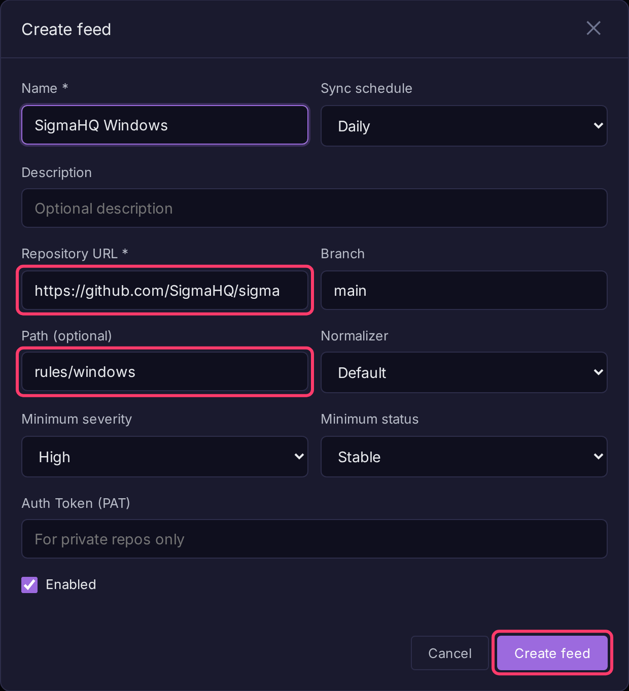

# Alert Feeds

An alert feed syncs detection rules from a Git repository into a fractal or prism. It imports Sigma rules (translated to BQL) and native Bifract alert YAML, and keeps them up to date on a schedule.

## Add a feed

Requires the tenant admin role.

1. Open a fractal or prism and select **Alerts** in the sidebar.
2. Open the **Feeds** tab and click **Manage feeds**.
3. Click **Add feed**.
4. Fill in at least **Name** and **Repository URL**, plus the [fields](#feed-fields) you need.
5. Click **Create feed**. To sync right away, click the **Sync Now** icon on the feed's row.



Imported rules appear in the **Feeds** tab. Click one to **Edit**, **Disable** or **Export YAML** it. Editing a feed rule saves a separate manual alert (**Save as Manual Alert**); the feed-managed original stays as it is.

## Feed fields

| Field | Description |
|-------|-------------|
| Name | Display name. |
| Sync schedule | `Never`, `Hourly`, `Daily` (default), `Weekly` or `Monthly`. |
| Repository URL | HTTP or HTTPS Git URL, e.g. `https://github.com/SigmaHQ/sigma`. |
| Branch | Default `main`. |
| Path (optional) | Subdirectory holding the rules, e.g. `rules/windows`. Empty means the whole repository. |
| Normalizer | Maps Sigma field names onto your log schema. `Default` uses the default normalizer. |
| Minimum severity | Skip rules whose Sigma `level` is lower. Order: informational, low, medium, high, critical. |
| Minimum status | Skip rules whose Sigma `status` is lower. Order: unsupported, deprecated, experimental, test, stable. |
| Auth Token (PAT) | Personal access token for private repositories. Encrypted at rest. |
| Enabled | Whether the feed syncs. |

## What a sync does

1. Clones the repository and reads every `.yml` / `.yaml` file under **Path**.
2. Creates alerts for new rules, updates changed ones and deletes rules that were removed.
3. Records every rule it skipped and why, which [ATT&CK Coverage](attack-coverage.md#close-a-gap) uses to show gaps a feed could close.

!!! note
    If the path lists no rule files, or none of the files could be used, nothing is deleted and the sync reports an error. A wrong path or branch cannot wipe the feed's alerts.

## Recommended community feeds

| Name | Repository URL | Path | Minimum severity | Minimum status |
|------|---------------|------|-------------|------------|
| SigmaHQ Windows | `https://github.com/SigmaHQ/sigma` | `rules/windows` | high | stable |
| Hayabusa Sysmon | `https://github.com/Yamato-Security/hayabusa-rules` | `sigma/sysmon` | medium | stable |

## Log source scoping

A Sigma rule's `logsource.category` becomes a `bifract_category` filter in front of its detection, so the rule only runs against the event type it was written for:

```yaml
logsource:
  category: process_creation
```

becomes

```
bifract_category=process_creation AND ( ...detection... )
```

Category names pass through unchanged, so **your normalizer should emit Sigma's category names**. These are aliased:

| Sigma `logsource.category` | `bifract_category` |
|---|---|
| `network_connection` | `network_connect` |
| `file_event`, `file_create` | `file_write` |
| `create_remote_thread` | `remote_thread` |
| `dns_query_unfiltered` | `dns_query` |
| `registry_add`, `registry_set`, `registry_delete`, `registry_rename` | `registry_event` |

Rules with no `logsource.category` (for example Windows Security log rules) are not prefiltered; they scope themselves with `EventID`.

!!! warning "Rules for event types you do not collect will not match"
    A `registry_set` rule matches nothing unless your normalizer sets `bifract_category=registry_event`. If a rule you expect to fire is silent, check that your normalizer emits the category its `logsource` declares.

## How Sigma values match

Bifract follows the Sigma specification:

- **Case is ignored** unless the field uses `cased`. `OriginalFileName: Cmd.Exe` matches `cmd.exe`.
- **`*` matches any run of characters, `?` exactly one**, in plain values and in `contains`, `startswith` and `endswith`.
- **A backslash escapes `*`, `?` or another backslash.** Before any other character it is literal, so Windows paths need no escaping. A separator followed by a wildcard must be doubled: `C:\Windows\\*` matches everything under `C:\Windows\`, while `C:\Windows\*` matches only the literal text `C:\Windows*`.
- **`Field: null`** matches an absent or empty field; `'*'` matches any non-empty value.

### Supported modifiers

| Modifier | Meaning |
|---|---|
| `contains`, `startswith`, `endswith` | Value appears anywhere in, at the start of, or at the end of the field |
| `all` | Every listed value must match, not just one |
| `windash` | A `-` or `/` starting a word also matches `/`, `-`, en dash, em dash and horizontal bar |
| `re` | Regular expression, case-sensitive |
| `re\|i`, `re\|m`, `re\|s` | Regex flags: case-insensitive, multiline, dot matches newline |
| `cased` | Match case-sensitively |
| `cidr` | Field is an IPv4 or IPv6 address in the range; not an address never matches |
| `exists` | `true`: field is present and non-empty; `false`: absent or empty |
| `gt`, `gte`, `lt`, `lte` | Numeric comparison; a missing or non-numeric field never matches |
| `fieldref` | Field equals another field's value; both must be present |
| `base64`, `base64offset` | Value base64-encoded, matched case-sensitively. `base64offset` needs `contains` and matches the value at any byte offset |
| `wide`, `utf16le`, `utf16be`, `utf16` | Encode the value as UTF-16 before `base64` or `base64offset` |

A rule using any other modifier (`expand`), `fieldref` with `contains`, `startswith` or `endswith`, an aggregation condition (`| count() by ...`) or a modifier combination such as `contains|endswith` is not imported. It shows in [ATT&CK Coverage](attack-coverage.md#close-a-gap) as `cannot be translated to BQL`.
