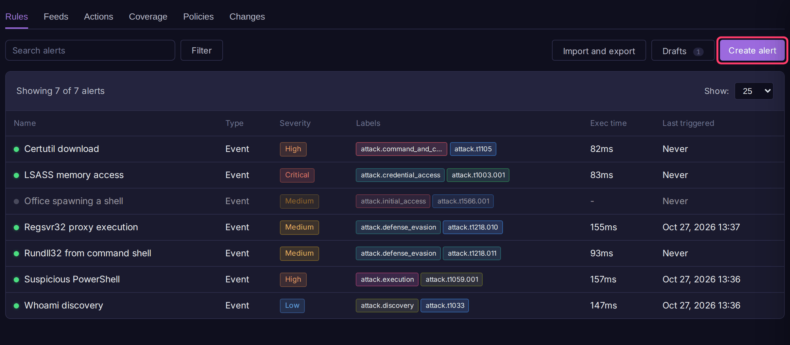
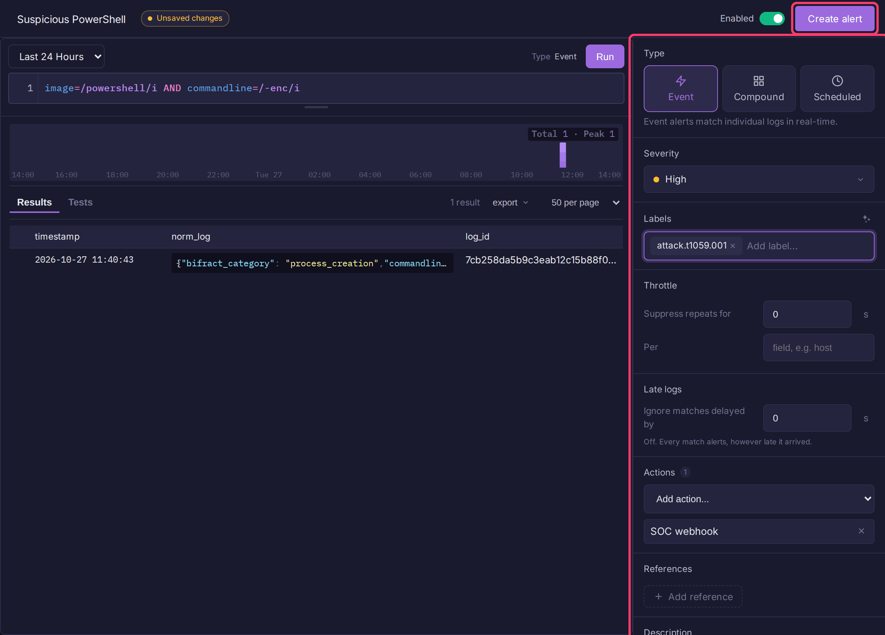
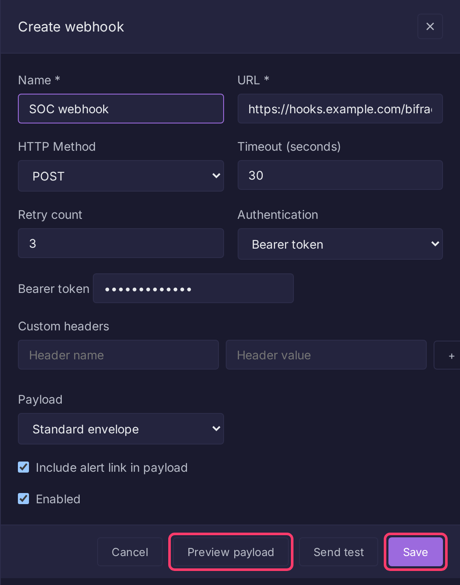

# Alerts

An alert is a BQL query that Bifract runs on a schedule, sending matches to one or more actions (webhook, email, fractal, lookup). Use alerts to turn a search into a detection.



## Create an alert

1. Open a fractal or prism and select **Alerts** in the sidebar. The **Rules** tab opens.
2. Click **Create alert**.
3. Type a name in **Name this alert**. `{{field}}` placeholders are filled from the first matching row.
4. Enter the BQL query and click **Run** to preview what it would have matched.
5. In the right-hand panel, pick a **Type** and **Severity**, and add **Labels**, **Actions**, **References** and a **Description** as needed.
6. Click **Create alert**.



To change an alert, click its row in the list, then **Edit**. The editor's **Tests** tab holds sample events the rule should or should not match; for testing rules from a repository or CI, see [Testing Rules](testing-rules.md).

To bring in existing rules, use **Import and export > Import YAML or Sigma**, or sync them from Git with [Alert Feeds](alert-feeds.md).

## Alert types

| Type | How it runs |
|------|-------------|
| **Event** | Matches new logs as they arrive. Cannot use aggregations (`groupBy()`, `count()` and so on). |
| **Compound** | Aggregates over a fixed **Window** (default 15 minutes), for thresholds such as "5 failed logins from one IP". |
| **Scheduled** | Runs on a **Schedule** (hourly, daily, weekly, monthly or a cron expression) over a **Query window** looking back from now. |

The editor sets the type from the query: an aggregation switches it to Compound.

## Editor fields

| Field | Description |
|-------|-------------|
| Severity | Critical, High, Medium, Low or Informational. Carried into action payloads. |
| Labels | Tags for filtering, e.g. `attack.t1059.001`. ATT&CK tags feed [ATT&CK Coverage](attack-coverage.md). |
| Throttle | **Suppress repeats for** a number of seconds, optionally **Per** field value (see [Throttling](#throttling)). |
| Late logs | **Ignore matches delayed by** more than this many seconds; 0 turns it off (see [Late logs](#late-logs)). |
| Actions | Actions to run on a hit. Actions are defined once and shared across alerts. |
| References | Links for context, e.g. MITRE ATT&CK pages. |
| Description | What the alert detects and what to do. Included in webhook payloads. |

## Create an action

1. In **Alerts**, open the **Actions** tab.
2. Click **Create action** and pick a type.
3. Fill in the form and click **Save**.
4. Attach it to an alert from the editor's **Actions** list.



| Action | What it does |
|--------|--------------|
| **Webhook** | Sends the alert to an HTTP endpoint (POST, PUT or PATCH) with optional auth, custom headers and a custom body template. **Preview payload** and **Send test** check it before saving. See [Webhooks](../api/webhooks.md). |
| **Email** | Emails recipients. Configure the mail server first under **Email settings**. |
| **Fractal** | Writes matching logs into a target fractal, so detections are searchable and can feed other alerts. |
| **Lookup** | Upserts matched values into a [lookup](../features/dictionaries.md), e.g. to build a watchlist of suspicious IPs. |

## How evaluation works

The alert engine evaluates every enabled alert on each tick (default every 60 seconds). Event alerts track a cursor on ingest time, so no logs are missed across restarts. One evaluation reads at most 10,000 rows.

Re-enabling a disabled alert restarts its cursor 5 minutes before now. Logs that arrived while it was disabled are not evaluated.

Execution history, including matched and suppressed counts, is under **System > Alert engine**.

## Throttling

A throttle suppresses repeat firings for a window. Without a **Per** field, the whole alert shares one window. With **Per** set to `host`, each host gets its own window: a new host fires while a host already seen stays suppressed.

Suppressed rows reach no action, including the system `alerts` fractal. Windows are stored in PostgreSQL, so a restart does not reset them.

## Late logs

Alerts evaluate on arrival time, so a source that reconnects and flushes a week-old backlog would fire on all of it. **Ignore matches delayed by** drops a match whose event time trails its arrival by more than the set number of seconds.

- The check is one-sided: an event dated in the future (a fast clock) is never dropped.
- It runs inside the ClickHouse query, so a compound alert counts only timely events and `join()` applies it to both sides.
- Dropped rows are not recorded anywhere.
- Restored archive data is never evaluated by alerts, so you do not need this setting for restores.
- The editor's **Tests** tab ignores it, since test events are old by nature.

## Fields sent to actions

A filter-only query (no pipeline commands and no `:=` assignments) reads just `timestamp`, `log_id`, the fields in its conditions, the **Per** throttle field and any `{{field}}` in the name. This keeps evaluation cheap, but means webhook, email and lookup actions receive only those fields.

Fractal actions are not affected: they re-fetch the full log for up to 1,000 rows per trigger.

To send more fields to a webhook, add an explicit `table()`:

```
image=/powershell/i | table(image, user, commandline, timestamp, log_id)
```

## Settings

Admins set these under **Settings > Platform > Alerts**. They are stored in PostgreSQL and apply without a restart.

| Setting | Default | Description |
|---------|---------|-------------|
| Query timeout | 5s | Maximum runtime of one alert query. An alert that exceeds it is disabled, with the reason shown on the alert. |
| Evaluation interval | 60s | How often the engine runs. Minimum 60s. |
| History depth | 10 | How many revisions each alert keeps for diffing and rollback. |
