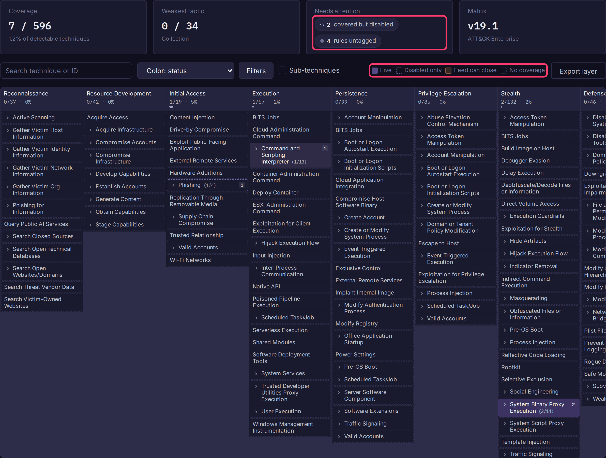

# MITRE ATT&CK Coverage

The **Coverage** tab maps your alerts' ATT&CK tags onto the ATT&CK Enterprise matrix, so you can see which techniques you detect, which rules are switched off, and which gaps a feed could close. It is scoped to the current fractal or prism.



## Open the map

1. Open a fractal or prism and select **Alerts** in the sidebar.
2. Open the **Coverage** tab.
3. Click any technique to open its drawer: tactics, **Covering rules** (click one to open it in the editor), platforms, **Expected telemetry**, and a link to attack.mitre.org.

Coverage comes from alert labels in Sigma tag form, which Sigma rules from [Alert Feeds](alert-feeds.md) already carry:

```yaml
tags:
    - attack.persistence
    - attack.t1543.003
```

## Read the map

Each column is a tactic in kill-chain order; each cell is a technique. With **Color: status** (the default):

| Legend | Meaning |
|---|---|
| **Live** | At least one enabled rule maps here. The badge shows the count. |
| **Disabled only** | Every rule mapped here is switched off. |
| **Feed can close** | No rule here, but a synced feed has rules for it that were not imported. |
| **No coverage** | No rule, and nothing waiting in a feed. |

Switch to **Color: rule count** or **Color: highest severity** when tuning depth rather than looking for holes.

The summary row shows:

| Tile | Shows |
|---|---|
| **Coverage** | Detectable units covered (see [How coverage is counted](#how-coverage-is-counted)). |
| **Weakest tactic** | The tactic with the lowest share covered. |
| **Needs attention** | Chips for gaps your feeds can close, techniques covered but disabled, untagged rules and broken tags. Click the first two to filter the map to those cells. |
| **Matrix** | The embedded ATT&CK version. |

Each column header shows a meter: the solid part is covered, the amber part is what a feed could close.

## Close a gap

1. Click an amber (**Feed can close**) cell, or the **gaps your feeds can close** chip.
2. The drawer lists the feed rules under **Available in your feeds**, each with the reason it is not running:

    | Reason | Fix |
    |---|---|
    | `below the feed severity threshold` | Lower the feed's **Minimum severity**. |
    | `below the feed maturity threshold` | Lower the feed's **Minimum status**. |
    | `cannot be parsed` | The rule YAML is invalid. |
    | `cannot be translated to BQL` | Bifract cannot express the rule's logic (see [supported modifiers](alert-feeds.md#supported-modifiers)). |
    | `failed to import` | The translated query was rejected by Bifract's parser. |

3. To write a new rule instead, click **Write a detection** in the drawer. The alert editor opens with the name, the `attack.tNNNN` label and MITRE's expected telemetry filled in.

!!! note
    Skipped rules are recorded on each feed sync. After an upgrade, gaps appear only once feeds sync again; click **Sync Now** on the feed under **Alerts > Feeds > Manage feeds** to populate them immediately.

## Controls

| Control | Effect |
|---|---|
| **Search technique or ID** | Dims non-matching cells and expands sub-technique groups that hold a match. |
| **Color** | Status, rule count or highest severity. |
| **Filters** | **Show** (all, gaps only, covered only), **Severity**, **Platform**, **Source** (all rules, manual only, or one feed) and **Enabled rules only**. The platform filter also narrows the total, so the percentage stays honest. |
| **Sub-techniques** | Expands every sub-technique group. Cells with a chevron expand individually. |
| **Export layer** | Downloads an ATT&CK Navigator layer (see below). |

## Export a Navigator layer

**Export layer** downloads the current view, with active filters applied, as an [ATT&CK Navigator](https://mitre-attack.github.io/attack-navigator/) layer. Scores are rule counts; each comment records the direct and inherited split. Use it to share coverage with people who have no Bifract access, to diff against another layer (an EDR vendor's claims, a red team, a threat group), or to keep dated snapshots.

## How coverage is counted

| Number | Counts |
|---|---|
| **Coverage** | Detectable units: every sub-technique, plus every technique without sub-techniques. Nothing is inherited, so a rule tagged `attack.t1547` covers none of its sub-techniques. |
| Top-level techniques touched (tooltip on **Coverage**) | Techniques with a rule on them or on any sub-technique. Often about twice the Coverage percentage, so use it for breadth only. |

Other rules:

- A sub-technique tag (`attack.t1543.003`) is direct coverage of the sub-technique and inherited coverage of its parent. The drawer shows both.
- A tactic-only tag (`attack.persistence`) covers nothing and counts as an untagged rule.
- A retired technique ID resolves to its replacement where ATT&CK defines one (`attack.t1086` counts toward T1059.001). One with no replacement is counted under **broken tags**.
- Deprecated techniques are excluded from every total.
- Old tactic names still work: `attack.defense-evasion` resolves to Stealth (renamed in ATT&CK v19) and the reverse.

## Update the ATT&CK matrix

The matrix is embedded in the binary (about 17 KB gzipped), so air-gapped installs work. Regenerate it when MITRE publishes a new version:

```sh
go run ./cmd/bifract-attackgen -out pkg/attack/data/enterprise-attack.json.gz
go test ./pkg/attack/...
```

This downloads MITRE's STIX bundle and writes the slimmed file; pass `-in enterprise-attack.json` to use a local copy instead. Commit the regenerated file.
