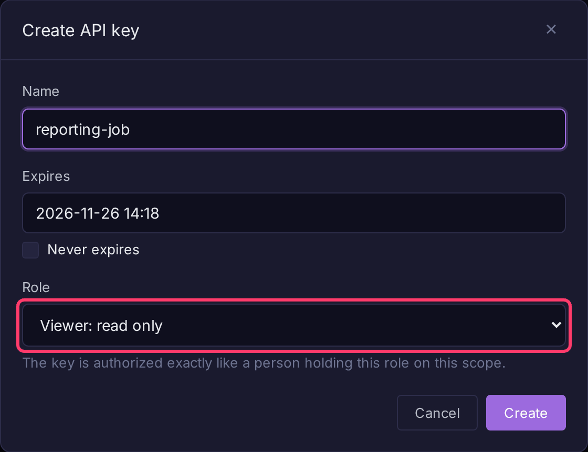

# Authentication

Bifract accepts three credentials: an API key for programs, an ingest token for log shippers, and a session cookie for the browser.

## API key

Send the key as a bearer token:

```
Authorization: Bearer bifract_<key>
```

`X-API-Key: bifract_<key>` also works.

A key belongs to one fractal or prism and carries one role: **Viewer** (read only), **Analyst** (read and write) or **Admin** (manage that scope). Its prefix names the scope, e.g. `bifract_default_...` for the fractal `default`. A tenant admin key (`bifract_admin_...`) administers the whole instance, has no scope, and must expire.

### Create a key for a fractal

1. Open the fractal and click **Fractal settings** in the sidebar (fractal admins only).
2. Open the **Access** tab.
3. In **API keys**, click **Create API key**.
4. Enter a **Name**, set **Expires** (or tick **Never expires**), and pick a **Role**.
5. Click **Create**, then copy the key from **API key created**. It is shown once.



Prisms have the same **Access** tab under **Prism settings**.

### Create a key as a tenant admin

1. Open **Settings** in the admin section of the sidebar, then the **API keys** tab.
2. Click **Create API key**.
3. Either pick a **Scope** and **Role**, or tick **Tenant admin** for an instance-wide key (an expiry is then required).
4. Click **Create** and copy the key.

See [API Keys](../administration/ingest-tokens.md) for more on roles. Keys can also be managed through the API ([All Operations](reference.md)).

## Ingest token

Log shippers use a `bifract_ingest_` token. It works only on the ingestion endpoints and writes to one fractal, so a leaked shipper token cannot read data. See [Log Ingestion](ingestion.md).

## Session

The web UI signs in with a username and password (or OIDC) and gets an `HttpOnly` cookie valid for 24 hours. Use an API key for scripts, so the credential can be scoped and revoked without touching a user account.

## Choosing a scope

A fractal or prism key is already bound to its scope. A session and a tenant admin key are not, so their requests name a scope:

```
X-Bifract-Scope: fractal:<fractal-id>
X-Bifract-Scope: prism:<prism-id>
X-Bifract-Scope: none
```

The header is checked on every request: asking for a scope you cannot reach returns `403`.

`none` means "no scope". Omitting the header is different: the server then falls back to the session's last selected scope.

## Errors

Failures use the standard error envelope. Branch on `code`, not on the message:

```json
{"success": false, "error": "Invalid username or password", "code": "unauthenticated"}
```

| `code` | Meaning |
|---|---|
| `unauthenticated` | Credential missing, malformed or wrong |
| `forbidden` | Credential valid, but lacks the role or scope the operation needs |
