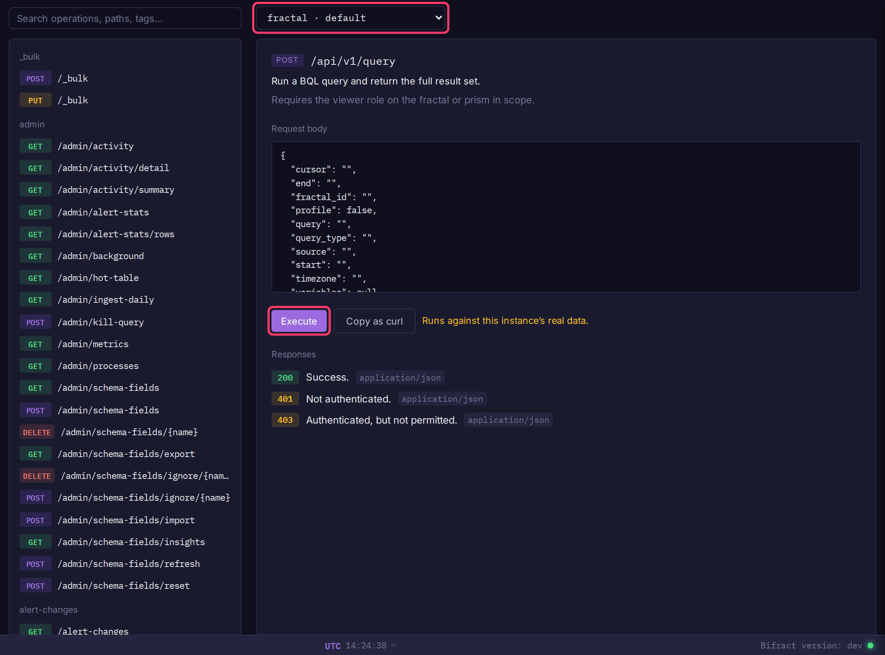

# API Reference

Every operation the server exposes, generated from its own router. Read [Authentication](authentication.md) first for keys and the scope header.

## Try the API in Bifract

Tenant admins can run any operation against their own instance:

1. Click **API** in the admin section of the sidebar.
2. Find an operation with **Search operations, paths, tags...**, or pick a quick start such as **Run a BQL query**.
3. Choose the scope from the selector next to the search box, fill in parameters and the request body.
4. Click **Execute**, or **Copy as curl** to run it elsewhere.

## All operations

<swagger-ui src="../openapi.json"/>
