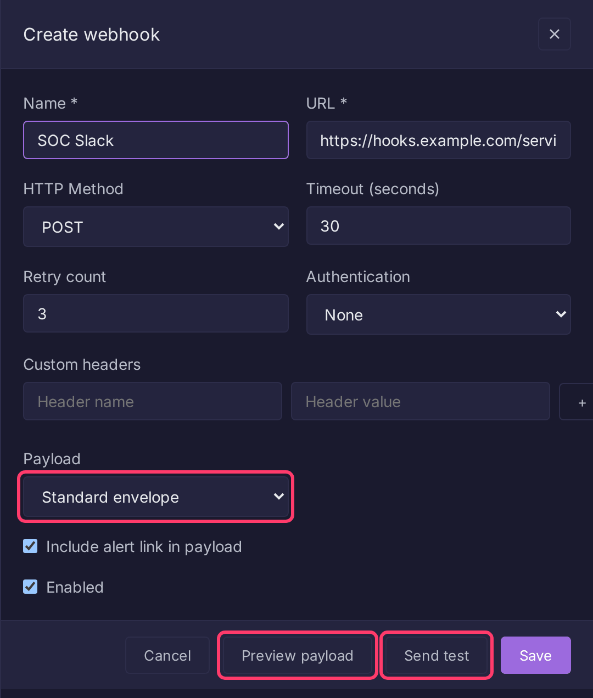

# Alert Webhooks

A webhook sends a firing alert to an outside system, such as a chat channel, ticket queue or SOAR playbook. This page covers setup, the fields a webhook takes, and the payload Bifract sends.

## Create a webhook

Webhooks are managed by tenant admins.

1. Open **Alerts** in the sidebar, then the **Actions** tab.
2. Click **Create action**, then the **Webhook** tile.
3. Fill in **Name** and **URL**. Optionally set **HTTP Method**, **Timeout (seconds)**, **Retry count**, **Authentication** and **Custom headers**.
4. Under **Payload**, keep **Standard envelope** or choose **Custom template** (see [Custom payloads](#custom-payloads)).
5. Click **Preview payload** to render it against sample data, or **Send test** to deliver it and see the response. Both work before saving.
6. Click **Save**. Then, in an alert's editor, pick the webhook from **Add action...** in the **Actions** section.



The same operations are in the API under `/api/v1/webhooks` ([All Operations](reference.md)).

## Fields

| Field | Type | Description |
|-------|------|-------------|
| `name` | string | Unique name |
| `url` | string | Destination, `http` or `https` only |
| `method` | string | `POST` (default), `PUT` or `PATCH` |
| `headers` | object | Custom HTTP headers |
| `auth_type` | string | `none`, `bearer` or `basic` |
| `auth_config` | object | `token` for bearer; `username` and `password` for basic |
| `timeout_seconds` | int | Request timeout (default 30) |
| `retry_count` | int | Retries with exponential backoff (1 s, 2 s, 4 s...). The UI defaults to 3; the API stores 0 if omitted |
| `include_alert_link` | bool | Add `alert_link` to the payload (default `true`) |
| `body_mode` | string | `envelope` (default) or `template` |
| `body_template` | string | Required when `body_mode` is `template` |
| `content_type` | string | `Content-Type` header (default `application/json`) |
| `enabled` | bool | Whether it fires. The UI defaults to on; the API treats an omitted value as `false` |

## Standard envelope

```json
{
  "alert_name": "Security Alert for 10.0.0.5",
  "original_name": "Security Alert for {{src_ip}}",
  "alert_id": "uuid",
  "description": "Detects suspicious login patterns",
  "severity": "high",
  "labels": ["sigma:high", "product:windows"],
  "triggered_at": "2026-03-01T12:34:56Z",
  "query_string": "event_id=4625 | count() > 10",
  "match_count": 15,
  "alert_link": "https://bifract.example.com/...",
  "results": [
    {"src_ip": "10.0.0.5", "user": "admin", "event_id": "4625"}
  ]
}
```

| Field | Description |
|-------|-------------|
| `alert_name` | Name with `{{field}}` templates filled from the first result |
| `original_name` | Present only when the name had templates |
| `results` | The matching records |
| `match_count` | Number of results |
| `alert_link` | Link to the results in Bifract, when `include_alert_link` is on. Built from `BIFRACT_BASE_URL`, else `https://` + `BIFRACT_DOMAIN` |

## Custom payloads

Set `body_mode` to `template` when the destination wants its own format. The template is [Go text/template](https://pkg.go.dev/text/template), rendered once per delivery. The form's **Splunk HEC**, **NDJSON rows** and **Slack message** buttons insert starting templates.

| Data | Description |
|------|-------------|
| `.AlertName`, `.OriginalName`, `.AlertID`, `.Description`, `.Severity` | Same as the envelope |
| `.Labels`, `.QueryString`, `.MatchCount`, `.AlertLink` | Same as the envelope |
| `.TriggeredAt` | Trigger time (Go `time.Time`) |
| `.Results` | Matching records, each a map of field name to value |

| Function | Description |
|----------|-------------|
| `toJSON` | Marshal any value to JSON, quoting and escaping strings |
| `field` | Read one key from a result, for names containing dots |
| `unixSeconds`, `unixMillis`, `rfc3339` | Format a time |
| `join`, `lower`, `upper`, `default` | String helpers; subject last so they pipe: `{{.Labels \| join ", "}}` |

Example: one [Splunk HEC](https://docs.splunk.com/Documentation/Splunk/latest/Data/HECExamples) event per match, sent to `/services/collector/event` with an `Authorization: Splunk <token>` custom header:

```
{{- range .Results}}
{"time":{{unixSeconds $.TriggeredAt}},"sourcetype":"bifract:alert","event":{{toJSON .}}}
{{- end}}
```

!!! warning
    Build every value with `toJSON` instead of quoting it yourself, e.g. `{"text":{{toJSON .AlertName}}}`. A field containing a quote or newline otherwise breaks the body.

Use `field` for dotted names, since `.host.name` reads as a nested lookup: `{{field . "host.name"}}`.

A template that does not compile is rejected on save. One that fails to render is reported without retrying. Rendered bodies are capped at 8 MB.

## Network access

Webhooks reach only public addresses by default. To deliver to a service inside your network, turn on **Settings** > **Security** > **Webhooks and Git repositories on the internal network**. Cloud metadata addresses are always refused, and HTTP proxy settings are not used.

A URL must not carry a username or password; use the **Basic** auth type instead. Redirects are not followed: a `3xx` answer, like a refused address, fails the delivery without retrying.
