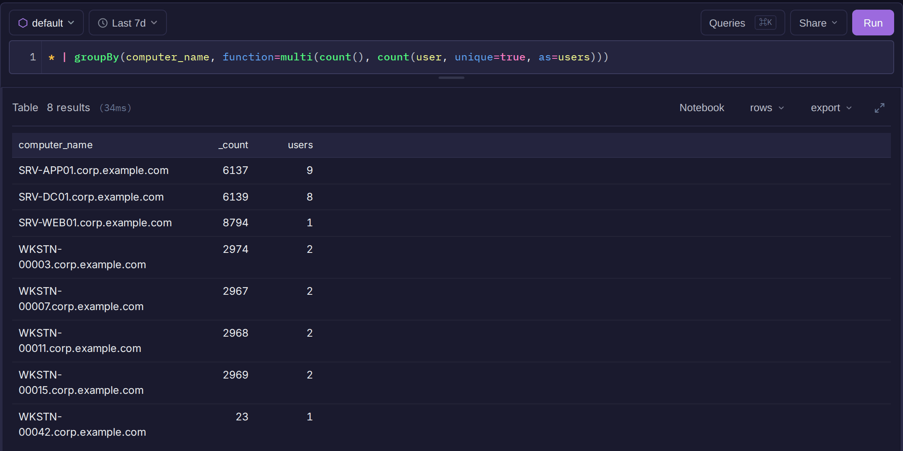

# Aggregation

Aggregations collapse matching logs into counts, statistics and groups. Use them to summarize activity, find top talkers, or spot outliers.



## Output columns

Each aggregate names its column after itself with a leading underscore: `count()` gives `_count`, `sum()` gives `_sum`. Use that name in later filters, `sort()` and `table()`.

`as=` renames the column. It is required when two aggregates of the same kind share a stage:

```
* | groupBy(host, function=multi(sum(bytes_in, as=rx), sum(bytes_out, as=tx)))
```

After an aggregation only its group keys and output columns exist. Filter on them with a later `|`:

```
* | groupBy(user, function=sum(bytes)) | _sum >= 1000000
```

## Group by

```
* | groupBy(image, user)
```

Without `function=`, each group gets `_count`. Pass `function=` for a different aggregate, or `multi()` for several:

```
* | groupBy(computer_name, function=multi(count(), count(user, unique=true, as=users), sum(bytes)))
```

| Parameter | Description |
|---|---|
| fields | One or more fields or expressions to group by |
| `function=` | Aggregate per group. Default: `count()` |
| `limit=` | Maximum number of groups returned |

A bare `| count()` after `groupBy()` counts the groups, not the rows in each:

```
* | groupBy(computer_name) | count()
```

## Basic aggregates

| Function | Output | Description |
|---|---|---|
| `count()` | `_count` | Number of rows |
| `count(field, unique=true)` | `_count` | Number of distinct values. `distinct=true` is the same |
| `sum(field)` | `_sum` | Total |
| `avg(field)` | `_avg` | Mean |
| `min(field)` / `max(field)` | `_min` / `_max` | Smallest or largest value. Works on `timestamp` |
| `median(field)` | `_median` | Median |
| `percentile(field)` | `_percentile` | The p50, p75 and p99 values. Not configurable |
| `stddev(field)` | `_stddev` | Population standard deviation. Alias `stdDev` |
| `skewness(field)` | `_skewness` | Population skewness. Alias `skew` |
| `kurtosis(field)` | `_kurtosis` | Population excess kurtosis. Alias `kurt` |
| `selectFirst(field)` | `_first` | Value from the earliest event |
| `selectLast(field)` | `_last` | Value from the latest event |

```
* | groupBy(user, function=avg(response_time))
```

!!! note
    `count(field)` counts every row, including rows without the field. To count only rows that have it, filter first: `user=* | count()`.

Statistical aggregates also work on a previous aggregation's output, for example the spread of per-host counts:

```
* | groupBy(computer_name) | skewness(_count)
```

## MAD

```
* | groupBy(computer_name, function=mad(latency)) | _mad > 50
```

`mad()` is the median absolute deviation (`_mad`), a measure of spread that extreme values do not skew. As a standalone command it also returns `_median`.

## Correlation

```
* | groupBy(src_ip, function=rankcorr(orig_bytes, resp_bytes, as=r)) | sort(r)
```

| Function | Output | Measures |
|---|---|---|
| `corr(x, y)` | `_corr` | Pearson: how closely the two follow a straight line |
| `rankcorr(x, y)` | `_rankcorr` | Spearman: whether one rises when the other does |

Values run from -1 (one falls as the other rises) through 0 (no relationship) to 1 (rise together). Both are empty for fewer than two rows or a constant field. Prefer `rankcorr()` for byte counts, durations and other heavy-tailed fields, where a few huge values can dominate `corr()`. Groups over 100,000 rows are ranked from a random sample, so `rankcorr()` can vary by about 0.003 between runs.

## Multi

`multi()` computes several aggregates in one stage:

```
* | groupBy(user) | multi(count(), avg(response_time), sum(bytes))
```

Inside `multi()` or `function=`, aggregates take named arguments: `count(field=event_id, distinct=true, as=unique_events)`. Two extra aggregates are available there:

| Function | Output | Description |
|---|---|---|
| `collect(field)` | `_collect` | All values of the field in the group, as an array |
| `top(field, percent=true)` | `_top` | The 10 most frequent values, with counts, or percentages when `percent=true` |

```
* | groupBy(user) | multi(collect(image), top(field=event_id, percent=true, as=top_events))
```

## Top

```
* | top(image, limit=5)
```

Returns the most frequent values of a field as `_top`. Default `limit=` is 10. `percent=true` shows each value's share of rows instead of its count.

## Frequency

```
* | frequency(status_code)
```

A frequency table, sorted by count: `_value`, `_count`, `_percentage` and `_cumulative_pct`.

## Head/tail (Pareto)

```
* | headTail(computer_name, threshold=90)
```

Same columns as `frequency()`, plus `_segment`: `head` for values within the first `threshold` percent of rows (default 80), `tail` for the rest.

## IQR

```
* | iqr(response_time)
```

Returns `_q1` (25th percentile), `_q3` (75th percentile) and `_iqr` (Q3 minus Q1).

## Modified z-score

```
* | modifiedZScore(response_time)
```

Adds `_median`, `_mad` and `_modified_z` to each row, where `_modified_z = 0.6745 * (x - median) / MAD`. Robust to outliers. Aliases `modifiedz`, `mzscore`.

## MAD outlier

```
* | madOutlier(latency, threshold=2.5) | _is_outlier = 1
```

Same as `modifiedZScore()` plus `_is_outlier`: 1 when `|_modified_z|` exceeds `threshold` (default 3.5), else 0. Alias `outlier`.

## Analyze fields

```
* | analyzeFields(response_time, bytes, limit=100000)
```

Per-field statistics: `field_name`, `_events`, `_distinct_vals`, `_mean`, `_min`, `_max`, `_stdev`. With no fields it analyzes all of them. Scans the first 50,000 rows by default; `limit=` raises that up to 200,000.
