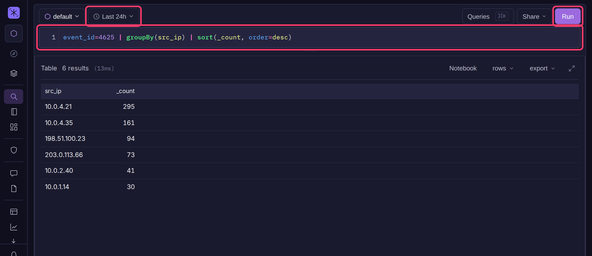

# Basics & Filtering

BQL is Bifract's query language for searching and analyzing logs. A query is a filter followed by commands, joined with `|`, and runs against the selected fractal and time range.



## Run a query

1. Open a fractal, then click **Query** in the sidebar.
2. Pick the time range with the time picker in the toolbar (default **Last 24h**).
3. Type a query in the query bar, for example `event_id=4625 | groupBy(src_ip)`.
4. Press **Enter** or click **Run**. **Shift+Enter** adds a new line.

While typing, type `?` inside a function's parentheses to see its signature, then click **Browse all** for the full reference. **Ctrl+/** comments out the current line.

## Query structure

```
filter | command() | command()
```

- Start with a filter, or `*` to match every log.
- A filter can also follow any `|`. It applies to the rows at that point: `level="a" | lowercase(level)` compares the original value, `lowercase(level) | level="a"` the lowercased one.
- A line starting with `//` is a comment. `//` after query text on the same line is not.

```
// failed logons, busiest source first
event_id=4625 | groupBy(src_ip) | sort(_count, order=desc)
```

## Filters

| Filter | Matches | Example |
|---|---|---|
| `*` | Every log | `*` |
| `=` | Exact value | `event_id=1` |
| `!=` | Not the value (also rows missing the field) | `status!=200` |
| `=/regex/` | Regex; add `i` for case-insensitive | `image=/powershell/i` |
| `!=/regex/` | Does not match the regex | `image!=/svchost/` |
| `=~` | Contains any of the terms, case-insensitive | `image=~powershell,pwsh,cmd` |
| `=^` | Starts with any of the terms, case-insensitive | `image=^mimikatz,impacket` |
| `=$` | Ends with any of the terms, case-insensitive | `image=$exe,dll,bat` |
| `=*` | Field is present and not empty | `user=*` |
| `>` `<` `>=` `<=` | Numeric comparison | `status_code>=500` |
| `"text"` or `/regex/` | Case-insensitive search of `norm_log`, the normalized event text | `"authentication failed"` |

`=~` is faster than an equivalent regex for multi-term searches. Quote a term that contains a space: `commandline=^"powershell -enc"`.

### Compare two fields

The right side of a comparison is a literal, so `src_port=dst_port` matches the text "dst_port". Wrap it in `field()` to compare against another field:

```
src_bytes > field(dst_bytes)
```

Works with `=`, `!=`, `>`, `<`, `>=` and `<=`. `=` and `!=` compare as text, the others as numbers. This cannot use a skip index, so put a selective filter in front of it.

### Value lists and IP ranges

```
* | in(status, "200,301,404")
* | cidr(src_ip, "10.0.0.0/8")
* | !cidr(src_ip, "10.0.0.0/8")
```

`in()` matches any listed value. `cidr()` matches addresses in the range; `!` negates either.

### Boolean logic

```
(status=error OR status=critical) AND NOT image=/svchost/
```

- `AND` binds tighter than `OR`. Use parentheses to group.
- Conditions with no operator between them are ANDed: `event_id=1 image=/powershell/i`.
- A field condition without an operator binds like `AND` (`a=1 OR b=2 c=3` is `a=1 OR (b=2 AND c=3)`). Any other term (NOT, a search string, a function, a group) ANDs with everything before it, so a new line starting with `NOT` applies to the whole query above it.
- `in()`, `cidr()` and other condition functions group and negate like any filter: `cidr(dst_ip, "10.0.0.0/8") OR cidr(dst_ip, "192.168.0.0/16")`.

## Variables

Queries in search, notebooks and dashboards can use `@name` placeholders. Set their values in the variables bar under the query.

```
user=@target_user AND image=@process
```

An unset variable becomes `*`, so the same query works across investigations by changing values instead of editing it.

## Bindings (`let`)

A `let` statement names a value, expression, filter or subquery so the query can reuse it. Statements come first, end with `;`, and are referenced with `&name`:

```
let &lolbin := lower(image) =~ "rundll32.exe","regsvr32.exe","mshta.exe";
let &officey := lower(parent_image) =~ "winword.exe","excel.exe";

* | &lolbin AND &officey | table(computer_name, user, image, commandline)
```

| Binding | Used as |
|---|---|
| `let &n := 500;` | `len(commandline) > &n` |
| `let &cmdlen := len(commandline);` | `&cmdlen > 500`, `table(&cmdlen)` (column named `cmdlen`) |
| `let &lolbin := lower(image) =~ "mshta.exe";` | `&lolbin`, `NOT &lolbin` |
| `let &user := "CORP\\rpatel";` | `user=&user`, `in(user, &user)` |
| `let &enc := /-enc(odedcommand)?\s/;` | `commandline=&enc` |

A misspelled `&name` is an error, never a field lookup. A binding may use one declared before it, not itself or a later one.

### Result sets

A binding whose value is a pipeline is a set of rows. Use it in `in()` or as a `join()` block:

```
let &admins  := user_type="admin" | groupby(user);
let &servers := role="server"     | groupby(computer_name);

event_id="4624"
  | in(user, &admins)
  | in(computer_name, &servers)
  | groupby(user, computer_name) | count()
```

`in()` tests the column with the same name as the field; a subquery returning a single column needs no name match. The subquery uses the same fractal and time range as the outer query and runs once even if referenced twice. This is how to test two subquery memberships, since `join()` cannot nest.

## Boolean parameters

Switches such as `require=`, `distinct=`, `percent=` and `directed=` are off by default. They accept `true`/`false`, `yes`/`no` or `1`/`0`; any other value leaves the default, so a typo cannot flip a switch.

`pgr()` is the exception: `reconnect=` and `diffuse=` default to on, so write `reconnect=false` or `diffuse=false` to turn them off.
