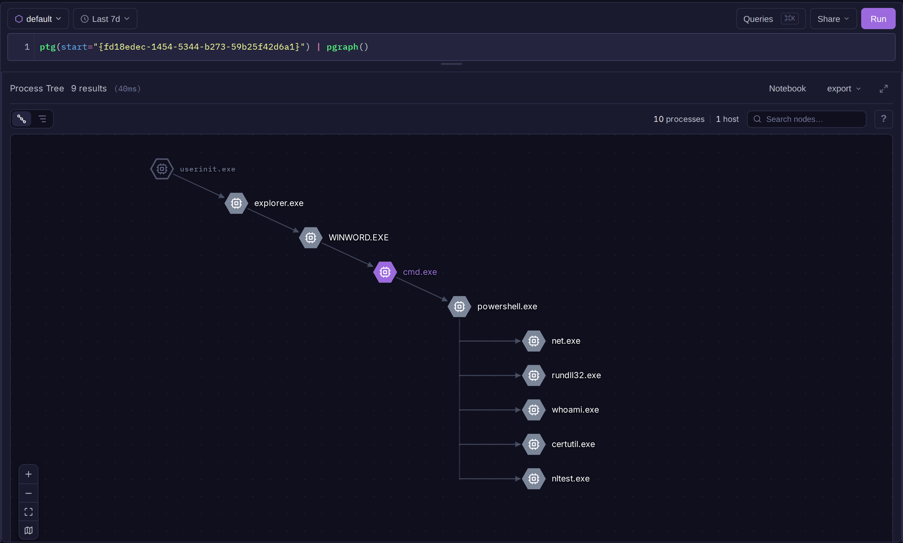

# Graph Traversal

`ptg()` (process tree graph) walks process lineage from one process, up to its ancestors, down to its descendants, or both. Use it to see what spawned a suspicious process and what it spawned in turn.

`ptg()` is a source: it starts the query, so it must come first in the pipeline.

## Syntax

```
ptg(start="<process_guid>", depth=N, direction=forward|backward|both)
```

| Parameter | Default | Description |
|-----------|---------|-------------|
| `start` (required) | | `process_guid` of the seed process |
| `depth` | 10 | Hops to follow from the seed. Capped at 50. |
| `direction` | `both` | `forward` for descendants, `backward` for ancestors, `both` for each |

Each row is one process: `timestamp`, `process_guid`, `parent_guid`, `image`, `parent_image`, `commandline`, `computer_name`, plus:

| Field | Description |
|-------|-------------|
| `_depth` | Hops from the seed (0 is the seed) |
| `_path` | GUIDs from the seed to this process, joined by ` > ` |
| `group_size` | How many identical processes the row stands for (1 for a single process) |
| `group_first`, `group_last` | When the first and last of them started, for `group_size` above 1 |

Siblings with the same parent, image and command line (user folders, GUIDs and long numbers ignored) are returned once, as the earliest of them, with a count: a process polling `cmd /C "tasklist"` every two seconds is one row, not thousands. A child that only one of them started still appears, under that row. The tree holds up to 1,000 rows standing for up to 500,000 processes; past that the result notes that it was truncated.

Pipe to `pgraph()` to draw the tree as a process map instead of a table.

## Requirements

`ptg()` reads `proc_lineage`, a table filled at ingest from events with `bifract_category="process_creation"` and a non-empty `process_guid`. Normalize your EDR source to that category and to the fields `process_guid`, `parent_process_guid`, `image`, `parent_image`, `commandline` and `computer_name`.

!!! warning
    Only `start=`, the time range and the fractal scope the tree. After `ptg()`, only `_depth`/`_path` filters, `pgraph()` and `graph()` are allowed; anything else is an error. Filters before `ptg()` are ignored. Processes outside the selected time range are silently left out, so set the range to cover the whole investigation.

`ptg()` reads live data only; it is not available over archived data.

## Examples

The full tree around a process, drawn as a process map:

```
ptg(start="{GUID}") | pgraph()
```



Ancestors only, up to 20 levels:

```
ptg(start="{GUID}", direction=backward, depth=20)
```

Descendants within three levels:

```
ptg(start="{GUID}", direction=forward) | _depth <= 3
```

## Beyond the spawn tree

`ptg()` covers process creation only. For file, network and DNS activity around the tree, anomaly scoring and cross-tree links, use `pgr()`: see [Provenance Graph](../features/provenance-graph.md).
