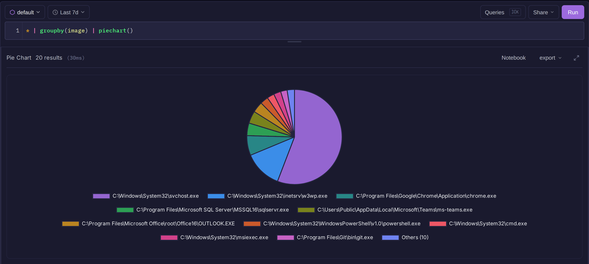
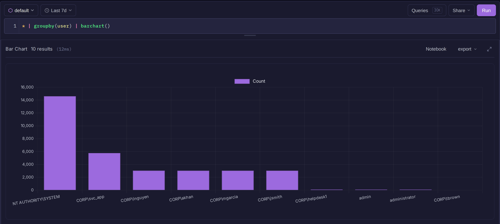
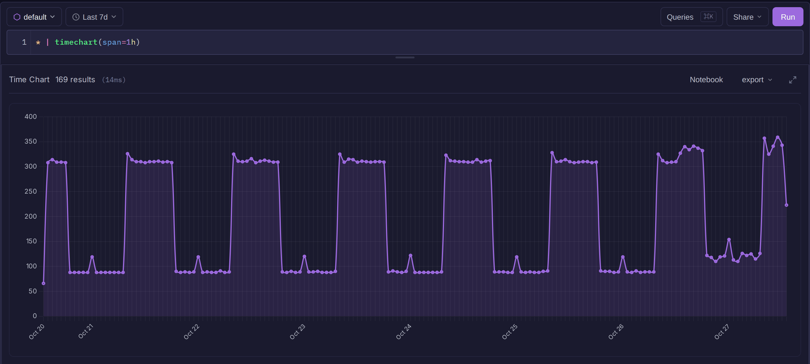
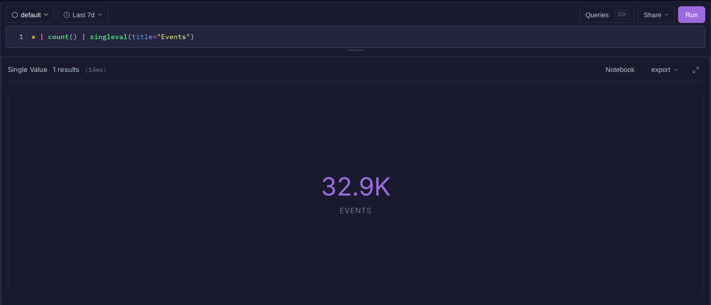
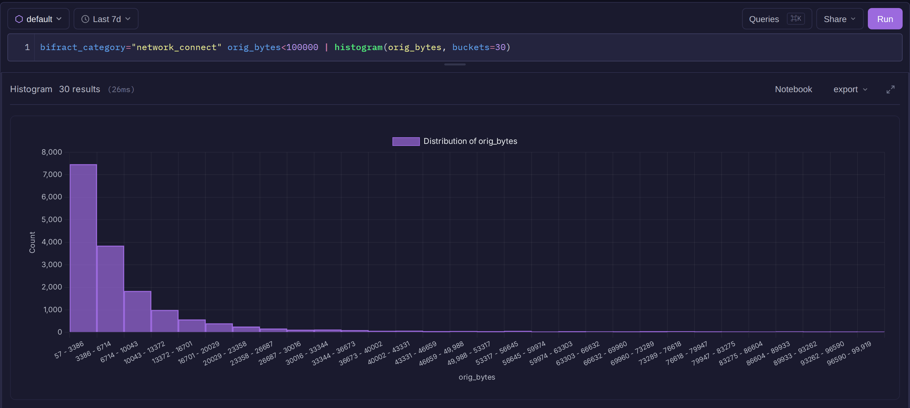
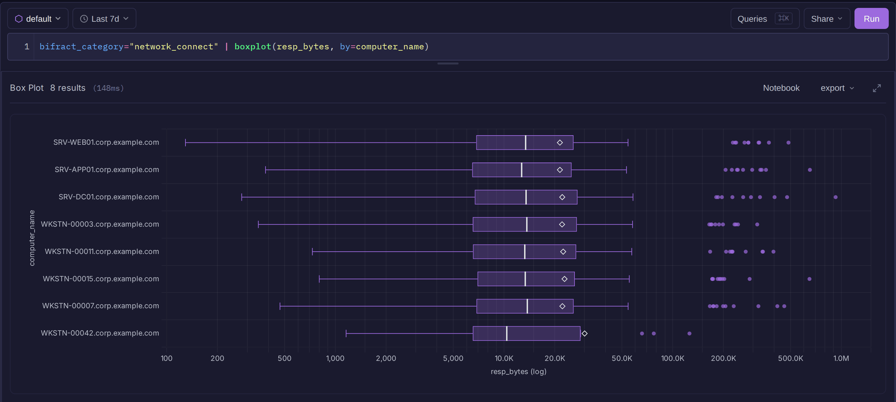
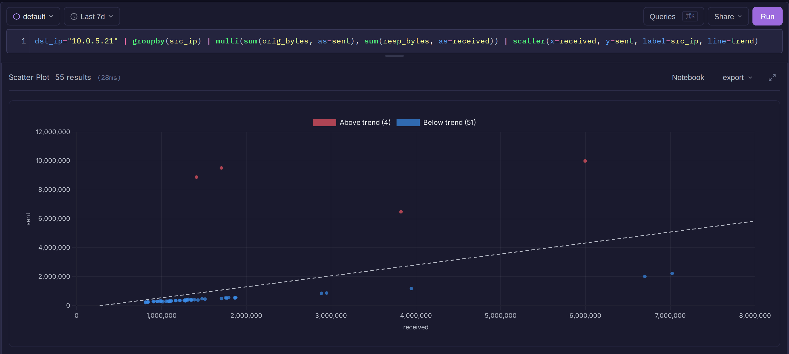
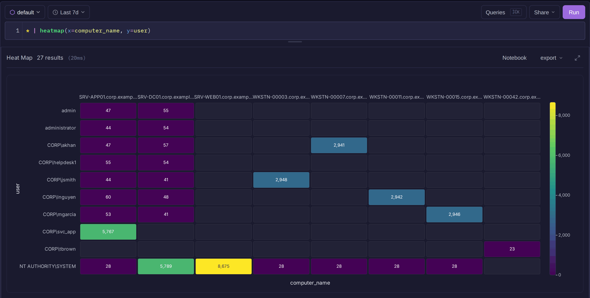
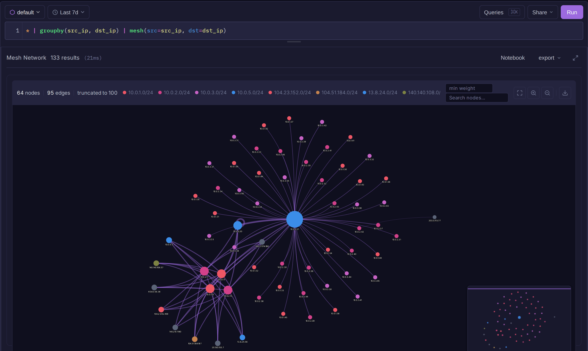

# Visualizations

A chart command at the end of a query draws its results as a chart instead of a table. Charts render in search, notebooks and dashboards.

| Command | Draws | Input |
|---------|-------|-------|
| [`piechart()`](#piechart) | share per group | `groupby()` output |
| [`barchart()`](#barchart) | count per group | `groupby()` output |
| [`timechart()`](#timechart) | values over time | log rows |
| [`singleval()`](#singleval) | one large number | a single-row aggregate |
| [`histogram()`](#histogram) | distribution of a number | log rows or an aggregate |
| [`boxplot()`](#boxplot) | quartiles and outliers | log rows or an aggregate |
| [`scatter()`](#scatter) | two numbers against each other | log rows or an aggregate |
| [`heatmap()`](#heatmap) | value per pair of fields | log rows |
| [`graph()`](#graph) | parent-child hierarchy | rows with a child and parent field |
| [`mesh()`](#mesh) | many-to-many network | `groupby(src, dst)` output |
| `pgraph()` | process map | `ptg()` or `pgr()`: see [Graph Traversal](graph-traversal.md) |
| `graphWorld()` | points on a world map | latitude and longitude: see [World map](field-operations.md#world-map) |

## Render caps and row limits

`piechart()`, `barchart()`, `graph()`, `mesh()`, `pgraph()` and `graphWorld()` accept both `render=` and `limit=`: `render=` caps the marks drawn, `limit=` caps the rows the query returns. For `boxplot()`, `scatter()` and `heatmap()`, `limit=` has the meaning given in their tables.

```
* | groupby(src_ip, dst_ip) | mesh(src=src_ip, dst=dst_ip, render=300, limit=5000)
```

## piechart()

```
* | groupby(image) | piechart()
```



Must follow `groupby()`. `render=` sets the slices drawn (default 10).

## barchart()

```
* | groupby(user) | barchart()
```



Must follow `groupby()`. `render=` sets the bars drawn (default 10).

## timechart()

Buckets events by time and aggregates each bucket.

```
* | timechart(span=1h)
```



One line per host:

```
* | timechart(span=1h, groupby(computer_name))
```

| Parameter | Default | Description |
|-----------|---------|-------------|
| `span` | `1h` | Bucket size: `s`, `m`, `h`, `d` or `w`, such as `5m` |
| `function` | `count()` | Per-bucket aggregate. May be written without `function=`. |

| Function | Plots |
|----------|-------|
| `count()` | events per bucket |
| `sum(f)`, `avg(f)`, `min(f)`, `max(f)` | that aggregate of numeric field `f` |
| `groupby(f)` | one line per value of `f` |
| `groupby(f, distinct=true)` | distinct values of `f` per bucket, as one line |
| `percent(f)` | share of rows where boolean `f` is true, one line per field |

`groupby(f) | timechart(...)` also draws one line per value of `f`.

!!! note
    Results stop at the instance row limit (250 rows by default), and each bucket of each line is a row. Over a long range, pick a larger `span` or fewer lines.

## singleval()

Shows one aggregate as a large number. The query must return a single row.

```
* | count() | singleval(title="Events")
```



`title=` sets the caption (default: the column name).

## histogram()

Splits a numeric field into equal-width bins.

```
bifract_category="network_connect" orig_bytes<100000
| histogram(orig_bytes, buckets=30)
```



| Parameter | Default | Description |
|-----------|---------|-------------|
| `field` (required) | | Numeric field |
| `buckets` | 20 | Number of bins, up to 200 |

## boxplot()

Summarizes a numeric field, optionally one box per group.

```
bifract_category="network_connect" | boxplot(resp_bytes, by=computer_name)
```



| Parameter | Default | Description |
|-----------|---------|-------------|
| `field` (required) | | Numeric field |
| `by` | | One box per value of this field, most frequent first |
| `fence` | 1.5 | IQR multiplier for the outlier fences, above 0 and up to 10 |
| `limit` | 20 | Most boxes, up to 100 |
| `outliers` | 10 | Extreme values kept at each end of each box, up to 100 |

The box spans Q1 to Q3, with a line at the median and a diamond at the mean. Values beyond `Q1 - fence x IQR` or `Q3 + fence x IQR` are drawn as outliers, and each whisker ends at the most extreme value inside its fence. The result table includes the fences, ready to use as alert thresholds. Quartiles are approximate (0.1% rank error) so the chart stays fast on large data.

## scatter()

Plots two numeric fields, one point per row.

```
dst_ip="10.0.5.21"
| groupby(src_ip)
| multi(sum(orig_bytes, as=sent), sum(resp_bytes, as=received))
| scatter(x=received, y=sent, label=src_ip, line=trend)
```



| Parameter | Default | Description |
|-----------|---------|-------------|
| `x`, `y` (required) | | Numeric fields for the axes. Must differ. |
| `label` | | Field that names each point in the tooltip |
| `line` | | `diagonal` (y = x) or `trend` (best fit). Points above and below the line are colored differently. |
| `limit` | 5000 | Most points, up to 50000 |

After an aggregation each point is a group; before one, each point is an event (the newest events carrying both values). Axes switch to log scale when values span three or more orders of magnitude. Use `line=trend` to find hosts that send unusually much for what they receive.

## heatmap()

Colors each pair of `x` and `y` values by an aggregate.

```
* | heatmap(x=computer_name, y=user)
```



| Parameter | Default | Description |
|-----------|---------|-------------|
| `x`, `y` (required) | | Fields for the axes |
| `value` | `count()` | `count()`, `sum(f)`, `avg(f)`, `min(f)` or `max(f)` |
| `limit` | 50 | Most distinct values per axis, up to 200 |

## graph()

Draws a top-down hierarchy from a child field and a parent field.

```
bifract_category="process_creation" computer_name="WKSTN-00042.corp.example.com"
| table(process_guid, parent_process_guid, image)
| graph(child=process_guid, parent=parent_process_guid, labels=[image])
```

| Parameter | Default | Description |
|-----------|---------|-------------|
| `child`, `parent` (required) | | Fields holding node IDs |
| `labels` | | Fields shown as node labels and details |
| `render` | 100 | Rows (edges) drawn, up to 500 |

## mesh()

Draws a force-directed network of source-to-destination links, for traffic, authentication or peer data.

```
* | groupby(src_ip, dst_ip) | mesh(src=src_ip, dst=dst_ip)
```



| Parameter | Default | Description |
|-----------|---------|-------------|
| `src`, `dst` (required) | | Fields for the two ends of each edge |
| `weight` | `_count` | Field setting edge thickness |
| `size` | `_count` | Field summed per node to set node size |
| `color` | `auto` | `subnet` (or `subnet/16`), `degree`, `role` (source or destination), or a field name (top 8 values). `auto` uses subnet when nodes look like IPs, else degree. |
| `labels` | all other fields | Fields shown in node details. A `color=` field must be among them. |
| `directed` | `false` | Draw arrows from source to destination |
| `render` | 100 | Rows (edges) drawn, up to 500 |

Each row is one edge, so aggregate with `groupby(src, dst)` first.
