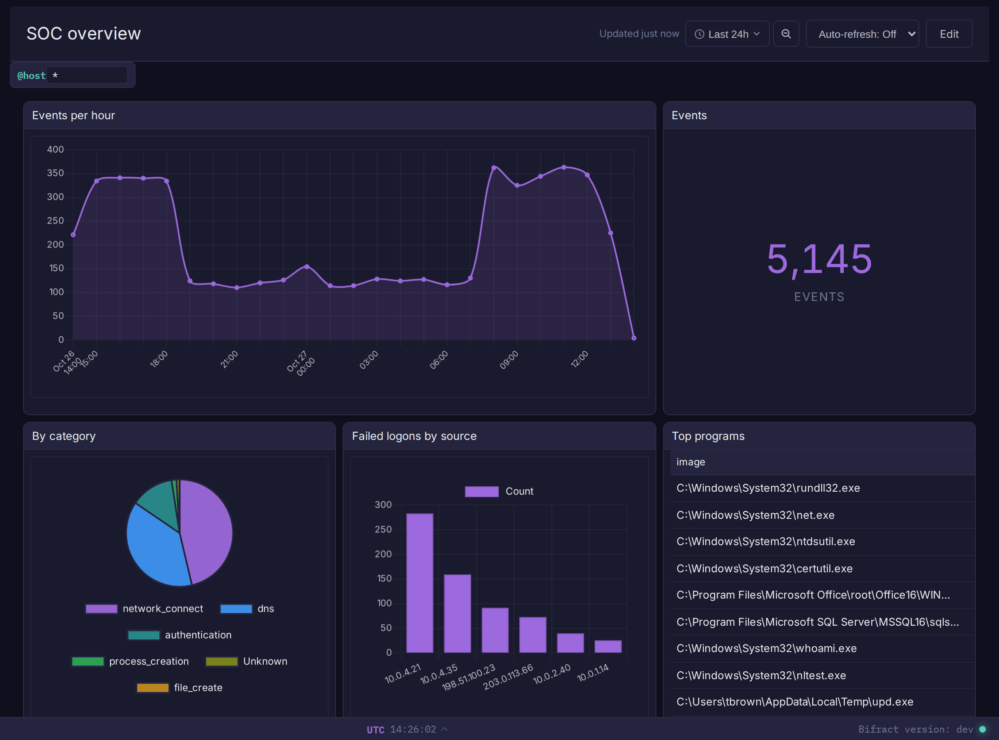
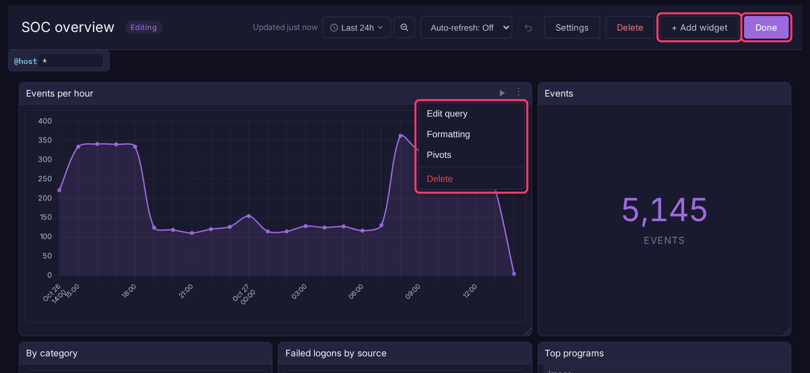
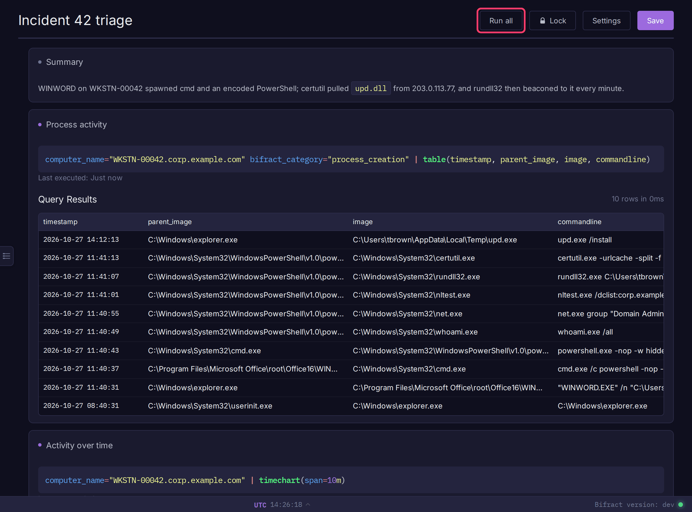

# Dashboards

A dashboard is a grid of widgets, each running its own BQL query. Use one for a monitoring view of a fractal or prism. For an investigation write-up that mixes notes and queries, use a [notebook](#notebooks) instead.

## Create a dashboard

1. Open **Dashboards** in the sidebar (under **Investigate**).
2. Click **Create dashboard**, enter a name and optional description, and save.
3. Click **+ Add widget**. A widget opens with its query editor.
4. Enter a **Widget title** and a BQL query, then click **Save**.
5. Arrange the widgets (see [Edit the layout](#edit-the-layout)) and click **Done**.

The query's last command picks the chart: `| piechart()`, `| timechart(...)`, `| worldmap(...)` and so on. A query with no chart command renders as a table. See [Visualizations](../bql/visualizations.md).

## Edit the layout

Dashboards open in view mode. Click **Edit** to change the layout, add or delete widgets, or open **Settings** (name, description, bucket timezone). Layout changes save as you make them and show for everyone viewing.

| Action | How |
|---|---|
| Move a widget | Drag its header. Other widgets move aside and float up to fill gaps |
| Resize a widget | Drag its right edge, bottom edge or bottom-right corner (24-column grid) |
| Edit a widget's query | Double-click its header, or **Edit query** in the widget's **⋮** menu |
| Chart options | **Formatting** in the widget's **⋮** menu |
| Move or resize with the keyboard | Tab to a header, then arrow keys to move or Shift + arrow keys to resize |
| Undo a layout change | The undo button or Ctrl+Z |

Below 760px wide, widgets stack in one column and layout editing is off.

## Time range and variables

Each dashboard has a default time range and default variable values. Any viewer can change them for their own view:

- **Time picker**: quick ranges, a rolling window, or an absolute range.
- **Zoom**: drag across a timechart to zoom in. **Zoom out** doubles the window; the back arrow returns to the previous range.
- **Variables**: a query that references `@name` adds a variable pill above the grid, defaulting to `*`. Type a value to re-run the widgets; the **x** on a changed pill restores its default.

Your changes stay in the URL, so reloading or sharing the link keeps them. While your view differs from the defaults, the header shows **Your view** with **Reset** and (analysts only) **Save as default**.

**Auto-refresh** (**Off**, **Auto**, or every 30s, 1m, 5m or 15m) re-runs widgets on the server so a wallboard stays current. Results are cached, so the dashboard opens with the last results while it refreshes.

## Pivots

To make a widget clickable, open its **⋮** menu and choose **Pivots**. Clicking a table cell or chart segment then passes that row to another **Dashboard** (as your view's variables) or the **Search page**.

## Share a read-only link

A shared link shows a dashboard without login, for wallboards. It serves **cached results only** and never runs BQL.

1. An admin turns on **Settings** > **Security** > **Dashboard shared links** (off by default).
2. Open the dashboard and click **Share**.
3. Optionally add a label, pick an expiry, and click **Create link**. Copy the URL; it is shown only once.

Revoke a link from the same dialog under **Active links**.

## Import and export

Export a dashboard from the **⋮** menu on its row in the dashboard list. Click **Import YAML** to load one into the current fractal. Files from the older 12-column grid (no `grid_columns: 24`) are scaled on import.

## Access

| Role | Can |
|---|---|
| Viewer | View dashboards and change the time range and variables for their own view |
| Analyst | Also create, edit and delete dashboards and widgets, and save a view as the default |

Dashboards and notebooks update live: edits by one user appear for everyone viewing, with presence avatars showing who else is there.

# Notebooks

A notebook is an ordered document of markdown and BQL query sections. Use it for investigations, runbooks and shared analysis.

## Create a notebook

1. Open **Notebooks** in the sidebar (under **Investigate**).
2. Click **Create notebook**, enter a name and optional description, and save.
3. Click **Add section** and pick a section type.
4. Write the markdown or query. Click **▶** on a query section to run it, or **Run all** to run every query section.
5. Click **Save**.

Drag sections to reorder them. **Settings** sets the notebook's time range (applied to every query section) and **Max Results per Section**. Notebooks support `@name` variables like dashboards.

Click **Lock** to make a finished notebook read-only: query sections stop re-running and keep their stored results. **Unlock** reverses it.

## Section types

| Type | Contents |
|---|---|
| **Markdown** | Notes and context |
| **Query** | A BQL query with cached results, optionally shown as a chart (**Format** in the section menu) |
| **AI Summary** | A generated summary of the other sections. One per notebook; needs AI configured |
| **AI Attack Chain Summary** | Findings mapped to MITRE ATT&CK tactics, each tactic collapsible and linked back to its comment. One per notebook; needs AI configured |
| Comment context | Created when you generate a notebook from comments: each comment's text, author, query and log |

To build a notebook from tagged comments, open the **Evidence** tab on the Notebooks page and click **File by tag**.

## Import and export

Notebooks export to YAML from their row menu. Click **Import YAML** on the Notebooks page to load one.
