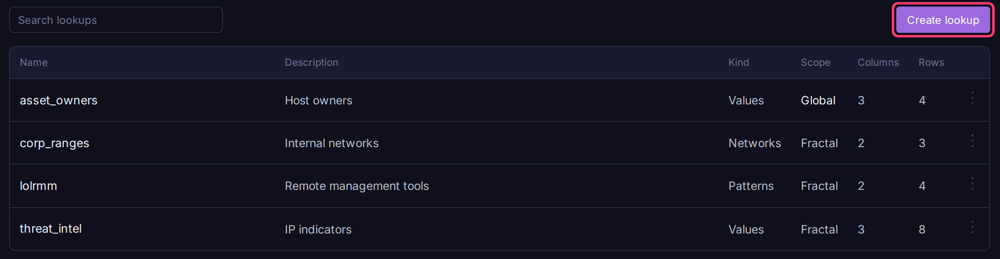
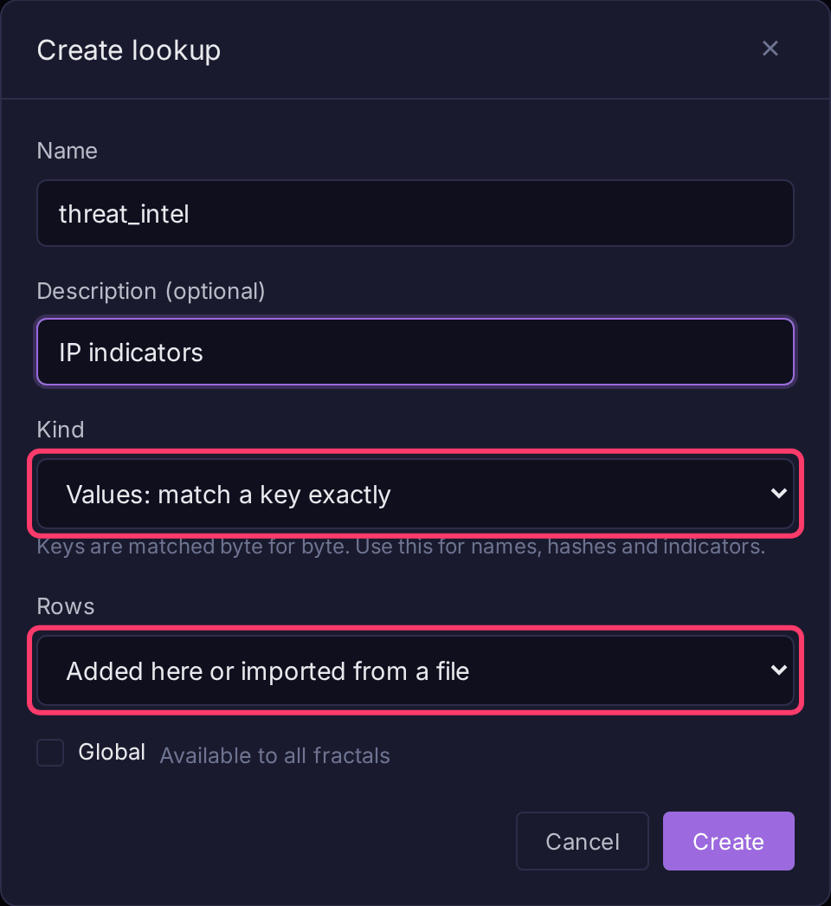
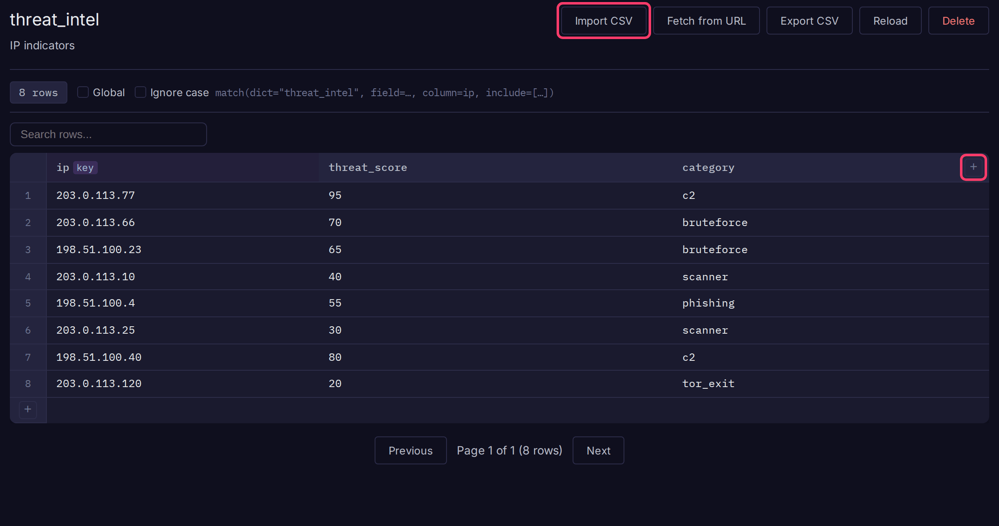

# Lookups

A lookup is a table you join onto query results with `match()`, for example to tag IPs from a threat feed or map hostnames to owners. Lookups belong to a fractal or prism and live on its **Lookups** page; BQL refers to one by name as `dict=`.



## Create a lookup

1. Open **Lookups** in the sidebar (under **Data**).
2. Click **Create lookup**.
3. Enter a **Name** (letters, digits and underscores) and an optional description.
4. Pick a **Kind**:

    | Kind | Keys are | Use for |
    |---|---|---|
    | **Values** | Exact strings | Names, hashes, indicators |
    | **Networks** | CIDR ranges; an address matches the narrowest range | Subnets, sites |
    | **Patterns** | Regular expressions; the first match in row order wins | Command lines, paths |

5. Leave **Rows** as **Added here or imported from a file**, or pick **Fetched from a URL and kept up to date** (admins only, see [Fill a lookup from a URL](#fill-a-lookup-from-a-url)).
6. Check **Available to all fractals** to make it global.
7. Click **Create**.



## Add data

Open the lookup to edit it like a spreadsheet.

1. Click **+** in the header to add a column. The first column you add is the key column.
2. Click **+** in the row-number column to add a row, or click **Import CSV** to drop in a file. The first CSV row must be headers; new columns are created and rows with an empty key are skipped.
3. Double-click a cell to edit it. Enter saves, Escape cancels.



Other controls:

- Click a column's key toggle to make it an extra lookup key. `match(column=...)` only accepts key columns. On a Networks or Patterns list, extra keys match exact values.
- **Ignore case** (Values lists only) matches keys whatever their casing.
- **Global** toggles visibility across all fractals and prisms.
- **Reload** forces ClickHouse to refresh its copy now. Row edits already do this.
- **Export CSV** downloads the rows.

On a Patterns list, put specific expressions above general ones: the first match answers.

## Use a lookup in a query

```
* | match(dict="threat_intel", field=src_ip, column=ip, include=[threat_score,category])
```

Add `require=true` to keep only matching rows. The editor shows a ready-made `match()` line for each lookup. See [Enrichment](../bql/enrichment.md) for every parameter and the per-kind behavior.

## Fill a lookup from a URL

A lookup can fetch its rows from a URL on a schedule, so a published list (a threat feed, a tool inventory) stays current. An admin either picks **Fetched from a URL and kept up to date** when creating it, or clicks **Fetch from URL** on an existing lookup, then fills in the fields and clicks **Save and fetch**.

| Field | Meaning |
|---------|---------|
| **URL** | An `http` or `https` address. The server fetches it |
| **Format** | **Detect**, CSV, TSV, JSON array, NDJSON, or one value per line. Gzip is unpacked either way |
| **Key column** | The file column holding the key. For a one-value-per-line file, the name to give that column |
| **Other columns to keep** | Comma-separated file columns. Empty keeps all |
| **Split key cells on** | Splits one key cell into a row per value, each with the record's other columns |
| **Keys are globs** | Patterns lists only: converts `*` and `?` wildcards to expressions. See [Glob keys](#glob-keys) |
| **Refresh every** | 15 minutes, hour, 6 hours, day or week (API: 5 minutes to 7 days). Default one hour |

Each refresh replaces every row with the file's contents, in file order. An unchanged file is skipped.

- If a fetch fails, returns no usable rows, or names a missing column, the existing rows stay and the error shows on the lookup. Retries start after 5 minutes and back off up to the refresh interval.
- Records with an empty or invalid key are skipped and counted.
- URL lookup rows are read-only (no editing, CSV import, or alert dictionary actions). **Detach** stops refreshing and makes them editable. **Edit source** changes the settings.
- Analysts can click **Refresh now**, at most once a minute. Only admins can set, change or detach a source.

!!! warning "Network access"
    Sources reach only public addresses by default. To allow private and loopback addresses, turn on **Settings** > **Security** > **Lookup sources on the internal network**. Cloud metadata addresses are always refused, and HTTP proxy settings are not used.

Limits: 64 MiB per file (512 MiB unpacked), 2 million rows, or 100,000 for a Patterns lookup.

### Glob keys

A glob matches ignoring case. `*` matches any run of characters and `?` any one, across path separators. A glob without `\` or `/` matches the last path segment. A glob of only wildcards is skipped.

| Glob | Matches |
|------|---------|
| `aeroadmin.exe` | `C:\Tools\AeroAdmin.exe`, `aeroadmin.exe` |
| `tigervnc*.exe` | `C:\bin\tigervnc-1.12.exe` |
| `C:\Users\*\AppData\Local\RemSupp\*` | anything under any user's `RemSupp` folder |

Example: flag processes running from a known remote-management tool's path using the [LOLRMM](https://lolrmm.io) list.

1. Create a **Patterns** lookup named `lolrmm`, fetched from `https://raw.githubusercontent.com/magicsword-io/LOLRMM/main/website/public/api/rmm_tools.csv`.
2. Set **Key column** to `InstallationPaths`, **Other columns to keep** to `Name,Description`, **Split key cells on** to `,`, and check **Keys are globs**.
3. Query:

```
* | match(dict="lolrmm", field=image, column=InstallationPaths, include=[Name,Description], require=true)
```

## Access and limits

- Analysts create and edit lookups; viewers can read them.
- All columns are stored as strings.
- Rows with a blank key are ignored, since they would match every log missing the field.
