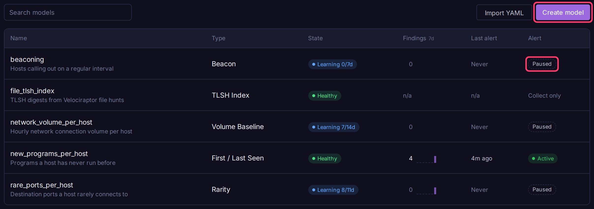
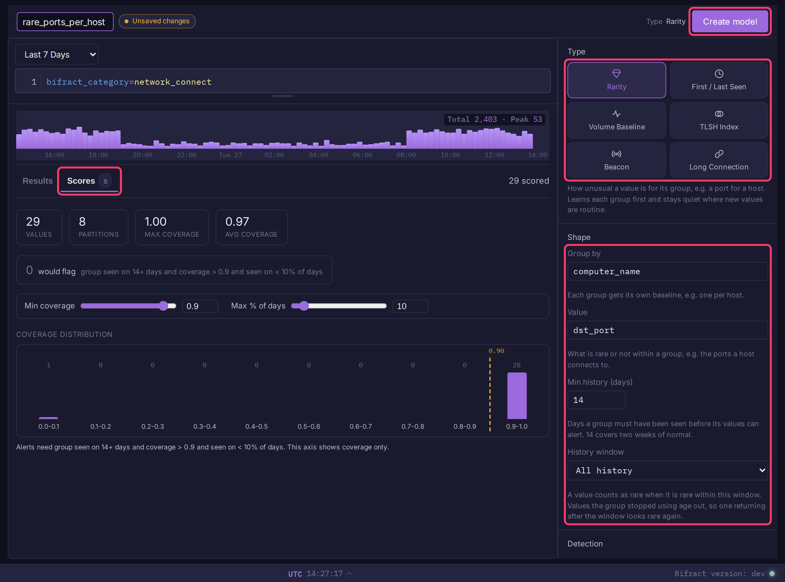
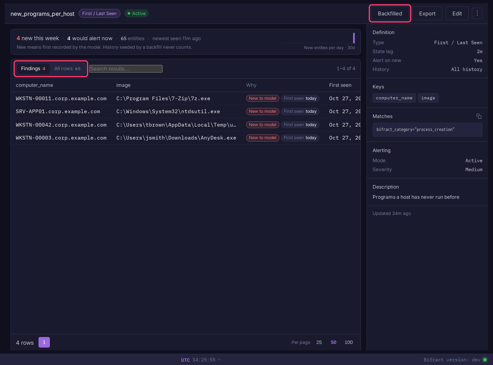

# Analytics Models

An analytics model turns a BQL query into a baseline that updates as logs arrive, and can raise an alert when something deviates from it. Use one when a fixed rule cannot say what "normal" is, for example a port a host has never used or a sudden spike in connections. Models are fractal-scoped and live on the **Analytics** page.



## Model types

| Type | Answers | Shape |
|------|---------|-------|
| **Rarity** | How unusual is a value within its group? | **Group by** (e.g. host), **Value** (e.g. port), **Min history (days)** |
| **First / Last Seen** | When was an entity first and last observed? | One or more key fields |
| **Volume Baseline** | Does an entity's volume deviate from its own history? | Entity fields, **Bucket** (per day or per hour), min history |
| **TLSH Index** | Which fuzzy-hash digests exist here? | One digest field. Not a detection on its own: it is what [`tlsh()`](../bql/enrichment.md#tlsh) probes instead of scanning every row |
| **Beacon** | Is this pair talking on a suspiciously regular interval? | Source, destination and port fields, bytes field, rolling window |
| **Long Connection** | Is this pair holding an unusually long-lived session? | Source, destination and port fields, duration field, rolling window |

## Create a model

1. Open **Analytics** in the sidebar (under **Data**).
2. Click **Create model**.
3. Pick a template under **Start from a template**, or click **Start blank**. A template fills the query, type, shape and thresholds.
4. Type a name in **Name this model**.
5. In the query box, write a BQL filter for the logs that feed the model (leave it empty to use every log). Click **Run** to preview matching logs and the fields you can key on.
6. In the right panel, pick a **Type**, then fill in **Shape** (see the sections below).
7. Set the thresholds under **Detection**.
8. Open the **Scores** tab to see what the model would flag over the last 1, 7 or 30 days, or a **Custom range** of up to 90 days. Moving a threshold recounts the flagged rows without another scan.
9. Click **Create model**.



Saving creates a paused alert with the chosen thresholds (TLSH Index creates none). Activate it from the **Alert** column on the Analytics page, and set actions, throttling and severity on the **Alerts** page. See [Alerts](../alerting/alerts.md).

A model records new logs from the moment it is created. To score older logs, [seed it with a backfill](#seed-history-backfill).

Templates:

| Template | Type | Shape |
|---|---|---|
| New programs per host | First / Last Seen | `computer_name`, `image` |
| Rare child of Office apps | Rarity | `image` per `parent_image` |
| New outbound ports per host | Rarity | `dst_port` per `computer_name` |
| Network volume spike per host | Volume Baseline, per hour | `computer_name` |
| Beaconing | Beacon | `src_ip`, `dst_ip`, `dst_port`, `orig_bytes` |

### Rarity

1. Set **Group by** to the field that gets its own baseline, e.g. `computer_name`.
2. Set **Value** to what is rare or common within a group, e.g. `dst_port`.
3. Set **Min history (days)**: days a group must be seen before its values can alert (default 14).
4. Optionally pick a **History window** (see [History window](#history-window)).
5. Under **Detection**, set **Min coverage** (default 0.9) and **Max % of days** (default 10).

### First / Last Seen

1. Add one or more fields under **Key Fields (entity to track)**, e.g. `computer_name` and `image`.
2. Optionally pick a **History window**.
3. Leave **Alert on new entities only** checked to alert on each new entity.

### Volume Baseline

1. Add one or more fields under **Entity Fields (baseline per)**, e.g. `user`.
2. Pick **Bucket**: **Per day** or **Per hour**.
3. Set min history (default 7 days, or 4 same-hour samples for hourly, at most 8).
4. Under **Detection**, set **Z-score threshold** (default 3.5).

### TLSH Index

1. Set **Digest Field** to the field holding TLSH digests.
2. Leave the source query empty. `tlsh()` only uses an index of the whole fractal, so a filtered one is refused on save; logs without a well-formed digest are skipped anyway.
3. Save, then run a backfill to index existing history.

### Beacon and Long Connection

1. Set **Source field**, **Destination field** and **Port field** (defaults `src_ip`, `dst_ip`, `dst_port`).
2. Beacon: set **Bytes field (connection size)**. Long Connection: set **Duration field (seconds)**.
3. Pick a **Rolling window**: 1, 7 or 14 days. Longer windows catch slower beacons.
4. Optionally link a **First seen from** model and a **Threat intel lookup** with its **Key column** (see [Network modifiers](#network-modifiers)).
5. Under **Detection**, set **Beacon score threshold** (default 0.8) or **Long-connection score threshold** (default 0.5).

The state keeps the earliest 84 connections per pair in each hour, so a busy pair is still scored across the whole day. Scoring and previews cover the window's complete hours, up to the start of the current one.

### Source query rules

- The query must keep one row per log. Filters, `match()` against a [lookup](dictionaries.md), CIDR ranges, regexes and lists are fine.
- Not allowed: aggregations, `sort`, `head`, `dedup`, anything that limits rows (`limit`, a chart's `limit=`), and commands that read outside the cycle's window (`join`, `chain`, `modelLookup`, `tlsh`, `pgr`). The editor names the reason inline.
- Use `regex()` to extract fields from `norm_log` or another field. `raw_log` cannot be a source: it is kept for only 7 days.
- A key can be a log field, a `regex(... as=)` extraction, or any column the query computes and names with `as=`. Generated names starting with `_` are refused. Network models cannot key on computed columns.

!!! warning "Computed keys follow their source"
    A key computed from a lookup takes the lookup's value when each cycle runs. Renaming a lookup entry splits one entity into two, and the new one looks brand new. Key on the stored field when that matters.

## Seed history (backfill)

1. Open the model from the Analytics page.
2. Click **Backfill**.
3. Pick **Last 24h**, **Last 7 days**, **Last 30 days**, **Last 90 days**, or **Custom range** (up to 90 days, in your display timezone).
4. Click **Start backfill**.

Progress shows per day and can be cancelled. A failed or cancelled backfill resumes from where it stopped without double-counting. A completed backfill cannot be run again; editing what the model records rebuilds it and clears its data, after which you can seed it again.

API: `POST /models/{id}/backfill` with either `window` or `from` and `to` (RFC 3339).

## View results

Click a model name to open it.



- **Findings** lists what the alert would raise, most unusual first. **All rows** lists everything the model scored, with sorting, search and paging.
- The summary line counts findings and, for Rarity and First / Last Seen, what was new this week.
- The **Why** column and row details give the facts behind each row (days seen, group coverage, latest against typical volume, regularity). Click a fact that names activity to search for it. **All columns** in the row details shows every stored column.

| Type | A finding is | Ordered by |
|---|---|---|
| Rarity | A value meeting the coverage and share-of-days thresholds | Share of days, then coverage |
| Volume Baseline | An entity whose `z_score` is above the threshold | `z_score`, highest first |
| First / Last Seen | An entity first recorded in the last 7 days | Newest first |
| Beacon, Long Connection | A pair whose score is above the threshold | Score, highest first |

TLSH Index has no findings. API: `GET /models/{id}/data?view=findings`.

## Model health

The **State** column shows the worst state that applies; hover for the reason.

| State | Meaning |
|---|---|
| **Error** | The model failed to build |
| **Not updating** / **Not started** / **Behind** | State maintenance is failing, never picked the model up, or lags the logs |
| **Rebuilding** | Its tables are being created |
| **Backfill n%** | History is being seeded |
| **Stale** | Newest recorded event is over 2 days old (3 hours for an hourly Volume Baseline) |
| **Learning k/n** | Not enough history yet: Rarity its learning period per group, Volume Baseline its min history, First / Last Seen 7 days, network models one full window |
| **Healthy** | Recording and scoring normally |

**Findings 7d** counts what the model surfaced in the last 7 days, with a daily sparkline for Rarity and First / Last Seen. **Last alert** is when the linked alert last fired. Both come from the model's own tables and are cached for two minutes.

## Use a model in queries

`modelLookup()` joins a model's output onto matching rows:

```
* | modelLookup(model="rare_parent_child", key=[parent_image, image])
```

See [Enrichment](../bql/enrichment.md#modellookup) for the key shape of each type.

## Import and export

Click **Export** on a model to download its YAML. Click **Import YAML** on the Analytics page to load one into the current fractal.

## Scoring reference

### How rarity is scored

Rarity counts **days**, not events: a value seen 10,000 times on one day counts once, so a burst cannot make itself look normal.

| Output | Meaning |
|---|---|
| `model_count` | Days the value was seen |
| `model_total` | Days the group was seen with any value |
| `percent` | `model_count / model_total`, the value's share of the group's days |
| `coverage` | Good-Turing coverage: 1 minus (values seen on only one day / total value-days). Near 1 means the group rarely produces new values |

The alert fires when `percent` is below **Max % of days** and `coverage` is above **Min coverage**. Example: port 22 seen once on a host that used ports 80, 443 and 8080 every day for 30 days scores `percent` 3.3 and `coverage` 0.99, so it alerts. On a host that uses a new port most days, `coverage` stays low and nothing alerts.

Learning period: a group must reach **Min history** days, and a value seen once only drops below the share threshold after more than 100 / threshold days (10% needs more than 10). The longer of the two applies.

### How volume is scored

Volume Baseline scores the latest **complete** bucket (`latest_bucket`, yesterday for a daily model) against the entity's own history. History runs from the entity's first bucket in the window (90 days daily, 30 days hourly) up to the scored bucket. Empty buckets count as zero.

Hourly models compare an hour only with the same hour on the same kind of day (UTC): weekday 3am against past weekday 3am hours, Saturday 2pm against past weekend 2pm hours. A weekday hour has about 21 samples in the window and a weekend hour 8, so hourly min history is at most 8. Daily models do not separate weekdays from weekends.

| Output | Meaning |
|---|---|
| `latest_count` | Events in `latest_bucket` |
| `baseline_median` | Median count per bucket over the history |
| `mad` | Median absolute deviation of the history |
| `n_buckets` | Buckets of history, empty ones included. Scored once this reaches min history |
| `z_score` | Modified z-score, `0.6745 * (latest_count - median) / mad` |

??? note "Edge cases"
    - When `mad` is 0, `z_score` is `(latest_count - median) / (1.253314 * mean absolute deviation)`.
    - When every bucket is the same, any change scores 1000000 (or -1000000 for a drop), shown as "flat history, any change".

### What "new" means for First / Last Seen

`first_seen` and `last_seen` are event times. `is_new`, which the alert fires on, is `1` when the model **first recorded** the entity in the last hour. So late logs and replayed data still count as new if the entity is new to the model.

- History seeded by a backfill never counts as new. Run the backfill before activating the alert, or entities only in history may fire once before the backfill reaches them.
- The **Data** view shows `recorded_at` in the row details (empty for seeded history).

### History window

By default Rarity and First / Last Seen remember everything they ever recorded. A **History window** (30, 90, 180 or 365 days in the editor; `history_days` 7 to 365 in the API) limits that:

- **Rarity** counts only days inside the window. A value the group stopped using ages out and is rare again when it returns. The window must be at least the learning period.
- **First / Last Seen** treats an entity as new again after N whole days without a sighting (7-day window: seen on the 1st, new again on the 9th). `first_seen`, `last_seen` and `event_count` describe the window. In the **Data** view, `since` is the day it returned.

!!! note
    A windowed model keeps one row per key per day for twice its window, so a long window on a high-cardinality key costs more storage, not less. Changing the window rebuilds the model; seed it again afterwards.

### Network modifiers

Beacon and Long Connection keep rolling per-pair state and score it on a schedule. The final score is the regularity (or duration) score plus up to three adjustments, clamped to 0 to 1. Each is stored with the pair (`prevalence_score`, `first_seen_score`, `threat_intel_score`) and named in the **Why** column.

| Modifier | Applies when | Default |
|---|---|---|
| Prevalence | Always. Boosts a destination at most 2% of the window's sources talk to; lowers one at least 50% talk to | +0.15 / -0.15 |
| First seen | A **First seen from** model is linked. Boosts a destination first seen in the last 7 days; lowers one first seen 90 or more days ago | +0.15 / -0.15 |
| Threat intel | A **Threat intel lookup** and **Key column** are set. Boosts a destination the lookup lists, matched as `match(dict=, column=)` | +0.25 |

The threat intel boost lets a listed destination with moderate regularity (0.55 or more) reach the default 0.8 beacon threshold.

??? note "Linking a First seen from model"
    - Key it on the network model's destination field (`[dst_ip]`), or source and destination in that order (`[src_ip, dst_ip]`) to judge the pair.
    - Save refuses a model keyed on anything else, one whose key its query rewrites (an extraction, `lowercase()`, a lookup), and one with a history window.
    - Seed it with a backfill. A destination first seen within 7 days of the start of its record (creation, rebuild, or a completed backfill's start) is not boosted. A destination it has no record of gets no adjustment.
    - If a linked model or lookup is deleted or unreadable, only that modifier stops applying; the scorer logs why.

??? note "Modifier fields in YAML and the API"
    `modifiers.first_seen_model`, `modifiers.threat_intel_lookup`, `modifiers.threat_intel_column`, cutoffs `first_seen_recent_days` (must be less than `first_seen_established_days`), `prevalence_low_threshold`, `prevalence_high_threshold`, and adjustments `prevalence_increase`, `prevalence_decrease`, `first_seen_increase`, `first_seen_decrease`, `threat_intel_increase`. A missing adjustment takes its default; a negative value turns it off.
