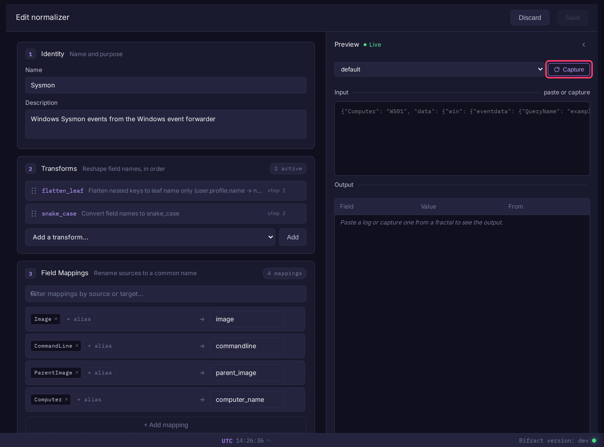

# Normalizers

A normalizer renames and reshapes fields as logs are ingested, so data from different sources shares one set of field names. It can also derive fields such as `bifract_category` and say where to read the event timestamp. Normalizers are assigned to ingest tokens.



## Create a normalizer

Tenant admins only.

1. Open **Normalizers** in the sidebar's admin section.
2. Click **Create normalizer**.
3. Enter a **Name** and optional **Description**.
4. Under **Transforms**, pick a transform from **Add a transform...** and click **Add**. Repeat; drag to reorder.
5. Under **Field Mappings**, click **+ Add mapping** and map one or more source names to a target.
6. Under **Derived Fields**, click **+ Add derived field** to map a field's values to a new field (for example `event_id` 1 to `bifract_category` `process_creation`).
7. Under **Timestamp Fields**, click **+ Add timestamp field** and give a field name and Go time format.
8. Check the **Preview** panel: paste a sample event, or pick a fractal and click **Capture** to pull recent logs. The output updates live.
9. Click **Save**.

To use it, pick it as the **Normalizer** on an [ingest token](../administration/ingest-tokens.md). Each token uses one normalizer. **Import YAML**, **Export**, **Duplicate** and **Set Default** are on the Normalizers page.

## Transforms

Transforms rename every field, in order.

| Transform | Example | Cannot combine with |
|-----------|---------|---|
| `flatten_leaf` | `user.profile.name` &rarr; `name` | `flatten_full`, `dedot` |
| `flatten_full` | `user.profile.name` &rarr; `user_profile_name` | `flatten_leaf`, `dedot` |
| `dedot` | `user.profile.name` &rarr; `user_profile_name` | `flatten_leaf`, `flatten_full` |
| `snake_case` | `UserID` &rarr; `user_id` | `camelCase`, `PascalCase` |
| `camelCase` | `user_id` &rarr; `userId` | `snake_case`, `PascalCase` |
| `PascalCase` | `user_id` &rarr; `UserId` | `snake_case`, `camelCase` |
| `lowercase` | `EventID` &rarr; `eventid` | `uppercase` |
| `uppercase` | `event_id` &rarr; `EVENT_ID` | `lowercase` |

## Field mappings

Map several source names to one target:

| Sources | Target |
|---------|--------|
| `userId`, `user_id`, `uid` | `user_id` |
| `srcIP`, `src_ip`, `source_address` | `src_ip` |

If one event has several fields that map to the same target, the one already named the target wins, otherwise the earliest source counting from the top. The preview flags these collisions.

### Map by raw path

A source starting with `$.` names a path in the raw event rather than a field name after transforms. Use it when two nested fields would otherwise get the same name, such as Velociraptor's `System.Execution.ProcessID` and `EventData.ProcessId`:

```yaml
field_mappings:
  - sources: [$.System.Execution.ProcessID]
    target: execution_process_id
```

??? note "Raw path rules"
    | Rule | Detail |
    |----------|--------|
    | Matching | Segments split on `.` and match raw JSON keys case-sensitively. A number selects an element of an array of up to 16 objects (`$.args.0.name`). Keys containing a dot cannot be addressed. |
    | Naming | Stored under the target exactly as written; transforms and other mappings do not rename it. |
    | Precedence | The path value always wins its target. Under `flatten_leaf` a clashing field keeps its full path (`event_data_process_id`); under `flatten_full` it is numbered (`execution_process_id_2`); a name-based mapping to the same target is dropped. Between two matching path sources, the first listed wins. |
    | Transforms | A nested path needs `flatten_leaf` or `flatten_full` before any rename transform. Without a flatten, only top-level keys (`$.EventID`) match. |
    | Sigma | Sigma rules use field names, so path sources never apply to them. |

## Event categories

`bifract_category` routes events into the [provenance graph](provenance-graph.md) and scopes [Sigma rules](../alerting/alert-feeds.md), so a normalizer for endpoint data should set it. Add it as a derived field (`value_mappings` in YAML):

```yaml
value_mappings:
  - from_field: event_id
    to_field: bifract_category
    map:
      "1": process_creation
      "3": network_connect
      "8": remote_thread
      "10": process_access
      "11": file_write
      "22": dns_query
```

Derived fields run after field mappings, so `from_field` must be the target name, not the original source name. An optional `default` sets the value when nothing in `map` matches.

Use Sigma's `logsource.category` names. The exception is registry: emit `registry_event` for all registry activity, and Bifract maps Sigma's four registry categories onto it. Unlisted categories are used as written.

| Category | Sysmon event | Builds graph edges |
|---|---|---|
| `process_creation` | 1 | yes |
| `network_connect` | 3 | yes |
| `file_write` | 11 | yes |
| `dns_query` | 22 | yes |
| `remote_thread` | 8 | yes |
| `process_access` | 10 | yes |
| `registry_event` | 12, 13, 14 | no |
| `image_load` | 7 | no |
| `ps_script` | PowerShell/Operational 4104 | no |
| `pipe_created` | 17, 18 | no |
| `driver_load` | 6 | no |
| `create_stream_hash` | 15 | no |
| `file_delete` | 23, 26 | no |

## Timestamp fields

Formats use Go layout syntax (`2006-01-02T15:04:05Z07:00` for RFC 3339), or `unix`, `unixmilli`, `unixmicro` or `unixnano` for epoch values. Bifract uses the first level that has timestamp fields configured:

1. The ingest token's timestamp fields.
2. Otherwise the normalizer's.
3. Otherwise the global timestamp settings.
4. Then common names (`timestamp`, `@timestamp`, `time`, `ts`, `_time`). If none match, ingest time is used.

## Default normalizer

The normalizer marked **Default** (set with **Set Default**) is applied to Bifract's internal logs. It cannot be deleted.

[Alert feeds](../alerting/alert-feeds.md) can also reference a normalizer, which renames fields in the imported rules to match your data.
