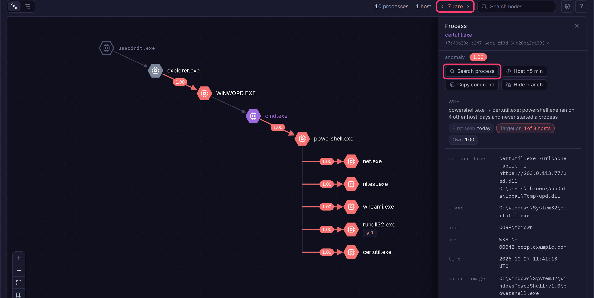

# Provenance Graph

The provenance graph (`pgr()`) rebuilds what a suspicious process did, scores every file, network, DNS and injection action by how unusual it is, and prunes the everyday noise. Use it to triage a process: a handful of suspicious actions surface instead of thousands of raw events.



## Turn it on

Provenance needs baselines built from endpoint logs, so it is off by default. A tenant admin enables it:

1. Open **Settings** in the sidebar, then the **Platform** tab.
2. Under **Endpoint analytics**, turn on **Collect baselines**.

Bifract then maintains two baselines as logs arrive: process lineage (who spawned whom) and behavior frequency (how common each file, IP and domain is across hosts). They run on every ingested log, so leave this off if you do not use `pgr()`. Baselines start from the moment you enable it.

## Investigate a process

1. Open **Query** and set the time range to cover the whole investigation; lineage outside the range is not included.
2. Find the process and copy its `process_guid`, for example:
   ```
   bifract_category=process_creation image=~powershell
   ```
3. Run:
   ```
   pgr(start="{GUID}") | pgraph()
   ```
4. Use the **‹ ›** arrows beside **N rare** in the stats bar to step through the processes with rare activity.
5. Click a process to open its drawer and pivot from there.

For just the spawn tree, without scoring or file, network and DNS activity, use `ptg(start="{GUID}") | pgraph()`. It reads only the lineage table, so it is faster. See [Graph Traversal](../bql/graph-traversal.md) for all arguments.

## Required fields

Your [normalizer](normalizers.md) must set `bifract_category` and the fields below (under the `fields` column). Every event also needs `computer_name` and a `timestamp`. `process_creation` alone builds the tree; each extra category adds a layer.

| `bifract_category` | Adds | Required fields | Sysmon event |
|--------------------|------|-----------------|---|
| `process_creation` | The spawn tree (required) | `process_guid`, `parent_process_guid`, `image`, `parent_image`, `commandline` | 1 |
| `file_write` | Files a process wrote | `process_guid`, `image`, `target_file` | 11 |
| `network_connect` | Outbound destinations | `process_guid`, `image`, `dst_ip` | 3 |
| `dns_query` | Domains a process resolved | `process_guid`, `image`, `query` | 22 |
| `remote_thread` | Injection edges (opt-in) | `source_process_guid`, `target_process_guid`, `image`, `target_image` | 8 |
| `process_access` | Handle-access edges (opt-in) | `source_process_guid`, `target_process_guid`, `image`, `target_image` | 10 |

Optional: `user` on `process_creation` (shown in the drawer) and `query_results` on `dns_query` (lets reconnection match resolved IPs).

!!! note "Injection edges are opt-in"
    `remote_thread` and `process_access` are left out by default because they force an unindexed scan per branch. Ask for them explicitly:

    ```
    pgr(start="{GUID}", include="remote_thread,process_access") | pgraph()
    ```

## Read the graph

| Control | What it does |
|---------|--------------|
| **Graph / Table** icons | Toggle between the canvas and an indented table. The table's time column shows the gap since the parent. |
| **Show all** / **Focus suspicious** | Larger scored graphs open focused: only processes on a path to red activity, plus the seed and its ancestors. The rest folds into `+N hidden` markers; click one to expand it. |
| **N rare** with **‹ ›** | Steps through processes with rare activity, centering each and opening its details. |
| Canvas controls | Zoom, fit and minimap, bottom left. The minimap is off until you turn it on. |
| Process drawer | Click a process. **Search process**, **Search hash** and **Host ±5 min** open searches in a new tab; **Copy command** copies the command line; **Hide branch** hides it (undo from the hidden branches stat). On a repeated process, **Search members** searches process creations with the same image and parent over its time span. |
| Keyboard (table) | `↑` `↓` or `j` `k` move, `Enter` opens the drawer, `←` `→` collapse and expand, `Esc` closes. |

### Repeated processes

A process that runs the same command over and over, such as a remote-access tool polling `cmd /C "tasklist | findstr"` every two seconds, is drawn once with a count: `cmd.exe ×47,900`. Siblings fold together only when they share a parent, an image and a command line (user folders, GUIDs and long numbers are ignored, as in scoring). Anything that differs stays its own node: a different command line, or a child that only one of the repeats started, still appears under the folded node. The repeats' files, connections and lookups all count, and the drawer shows when the first and last one started.

### When the graph is incomplete

`pgr()` returns up to 500 edges by default (`limit=` raises it, up to 20,000) and walks up to 1,000 nodes standing for up to 500,000 processes. A quarter of the edge budget is kept for file, network, DNS and reconnection edges, so a wide tree cannot crowd them all out. When either limit cuts the graph, the stats bar shows **row limit reached** or **tree truncated**; hover it for the counts.

## Anomaly scoring

Every action gets an `anomaly_score` from 0 (common everywhere) to 1 (never seen before). Scores also add up along the chain, so a sequence of individually common steps (living off the land) still stands out.

- **Host-days, not events.** An action counts once per host per day, so 10,000 beacons to one IP is one host-day.
- **Leave-one-out.** The tree being scored is subtracted from the baseline, so an attack never vouches for itself.
- **Known source.** For an image that ran on other hosts, the score is how rarely it made this move elsewhere: `winword.exe` starting its first-ever child scores 1.
- **New source.** For a binary never seen on another host, the score is how rarely anyone touched the target.

Each action shows a **Why** sentence and fact chips in the drawer and on edge hover, for example `cmd.exe → node.exe: never seen from cmd.exe on any other host` with **First seen**, **Target on**, **Other host-days**, **Own** and **Inherited**. Clicking **Target on** searches that IP, domain, file or image in a new tab.

??? note "Score columns"
    | Column | Meaning |
    |--------|---------|
    | `edge_score` | The action's own score; `anomaly_score` minus it is what the chain added |
    | `score_basis` | `transition` (known source), `new_source`, `no_source` (parent never logged), or `reconnect` |
    | `edge_host_days` | Other host-days on which this source made this exact move |
    | `source_host_days` | Other host-days on which this source made any move of this type |
    | `source_exec_host_days` | Other host-days on which this source binary ran |
    | `target_host_days` | Other host-days on which any process touched the target |
    | `target_hosts`, `total_hosts` | Hosts that touched the target (capped at 256) out of all hosts |
    | `first_seen` | First day the relationship was observed |
    | `group_size` | On a spawn edge, how many identical processes the child node stands for (1 for a single process) |
    | `group_first`, `group_last` | When the first and last of those processes started, for `group_size` above 1 |
    | `recon_role` | On a reconnection bridge: `lead`, `shared` (part of a wide family of shared artifacts), or `context` |

## Reconnection

`pgr()` also pulls in other process trees that share a **rare** artifact with the seeded one: a file this tree wrote that another tree executed, or the same rare IP or domain. This is how lateral spread shows up. Common artifacts (CDNs, resolvers, update servers) do not bridge.

- **Lateral leads** are drawn beside the tree: the shared artifact next to the process that touched it, and a **Lateral** column with each host reached through it. The stats bar shows them in red, for example **2 hosts reached via 203.0.113.87**; click it to jump there. A link is a lead when it reaches another host, the seed's own process had no business touching the artifact (its own score for that edge is high; a file it dropped that another host ran always counts), and that process does not share many artifacts with other hosts. Up to 3 artifacts are promoted, strongest first.
- Every other link is context. When there are leads, or more than 3 links, it folds into one **Linked** summary below the tree, which says why: an agent sharing dozens of telemetry domains with the fleet reads as **shared software**. Click **show** to open it as the **Reconnected** section, grouped by the artifact that links them, strongest first; click a peer to expand its tree.
- Up to 50 peers are admitted by default. Change it with `peers=` (max 500), or turn reconnection off with `reconnect=false`:

```
pgr(start="{GUID}", peers=200) | pgraph()
```
