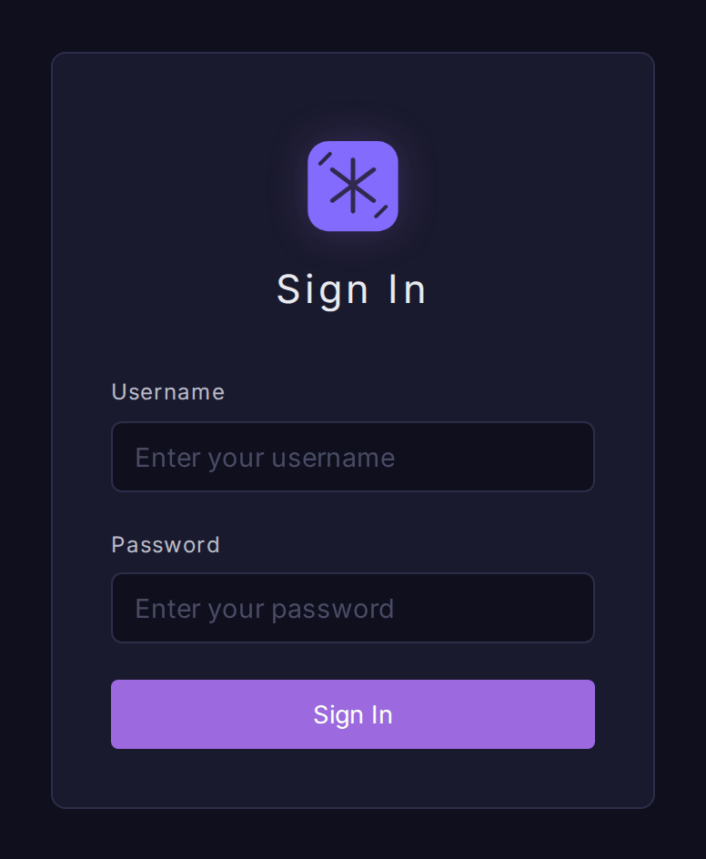
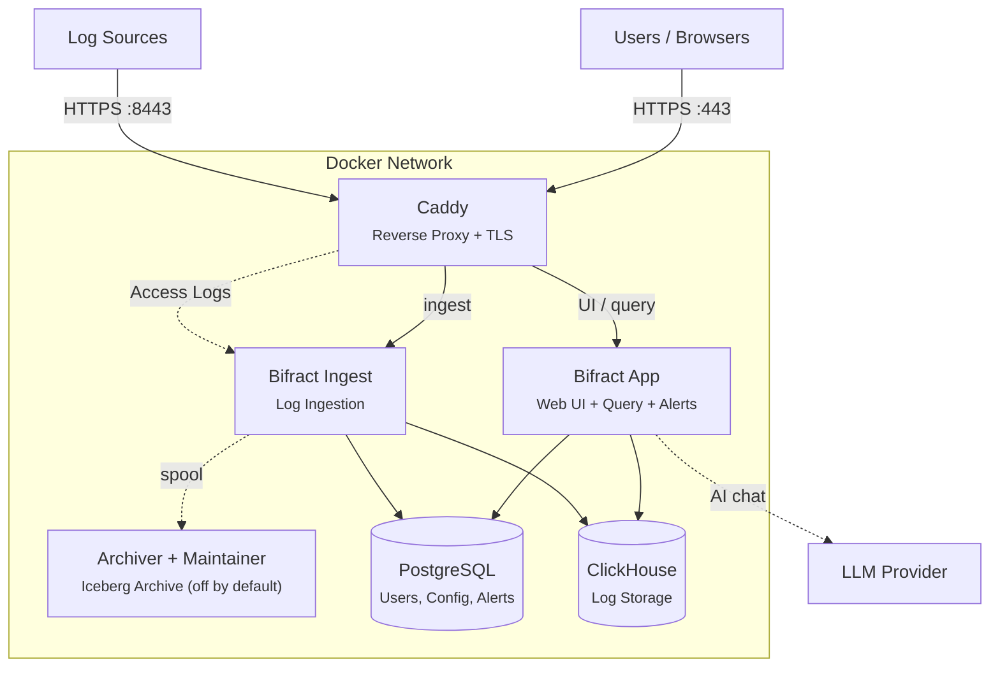

# Installation

Install Bifract on a single Linux host with Docker Compose. The `bifract` CLI runs a setup wizard that generates passwords, TLS certificates and the Compose stack, then starts it. For a multi-node cluster, see [Kubernetes](kubernetes.md); to install from a config file (cloud-init, Ansible, CI), see [Non-interactive Install](non-interactive.md).

## Requirements

- Linux on amd64 or arm64.
- Docker with the Compose plugin (`docker compose`). The wizard checks both before it continues.
- Ports 443 (UI and API) and 8443 (log ingest) reachable by users and log sources. Port 80 is also published; Let's Encrypt needs it.

Recommended hardware by daily raw log volume:

| Daily ingest | CPU cores | RAM |
|---|---|---|
| 10 GB | 4 | 8 GB |
| 50 GB | 8 | 16 GB |
| 100 GB | 16 | 32 GB |
| 250 GB | 16 | 64 GB |
| 500 GB | 32 | 128 GB |

For disk, ClickHouse typically compresses structured logs 7 to 10 times, so 10 GB/day of raw logs needs roughly 1 to 1.5 GB/day.

## Install

1. Download the CLI and start the wizard:

    ```bash
    curl -sfL https://docs.bifract.io/install.sh | sh
    ```

    This installs `bifract` to `/usr/local/bin` and runs `sudo bifract --install`. Set `BIFRACT_VERSION` (for example `BIFRACT_VERSION=v1.2.3`) to pin a release. The script checks the binary against the release's signed checksums; see [Verifying Releases](verifying-releases.md).

2. Answer the wizard steps:

    | Step | Options |
    |---|---|
    | Directory | Where config and data live. Default `/opt/bifract`. |
    | ClickHouse | **Bundled (recommended)**, **External ClickHouse** or **ClickHouse Cloud**. See [ClickHouse Cloud](clickhouse-cloud.md). |
    | Domain | Hostname or IPv4 address users will browse to. Use `localhost` for a local test. |
    | SSL | **Self-signed (default)**, **Let's Encrypt (automatic)** (needs a public domain and an email) or **Custom certificates** (paths to a cert and key). |
    | IP access | Restrict the UI, everything, require mTLS client certificates, or allow all. See [Access control](../administration/reverse-proxy.md#access-control). |

3. On **Ready to Install**, press Enter. The wizard writes the config, pulls images and starts the stack.
4. Copy the admin password from the summary. It is shown only once.

## Log in



1. Open the URL from the summary, for example `https://bifract.example.com`. With a self-signed certificate, accept the browser warning.
2. Sign in as `admin` with the password from the summary.
3. Open the `default` fractal and start sending logs: see [Ingestion](../ingestion/overview.md).

## Upgrade

```bash
sudo bifract --upgrade
```

`--upgrade` first updates the `bifract` CLI itself if a newer release exists (skip with `--skip-self-update`), then upgrades the stack in place. The new CLI is installed only if its checksum and Sigstore signature verify.

!!! warning "ClickHouse cannot be downgraded"
    An upgrade can move the bundled ClickHouse to a newer version. After it starts, do not go back to an older `docker-compose.yml`: an older ClickHouse cannot read data the newer one wrote, so those logs disappear from search. See [Rolling back after a ClickHouse upgrade](../administration/backup-restore.md#rolling-back-after-a-clickhouse-upgrade).

## Manage the install

All commands default to `/opt/bifract`; pass `--dir <path>` for another directory.

| Command | What it does |
|---|---|
| `sudo bifract --status` | Show deployment status and health |
| `sudo bifract --start` / `--stop` | Start or stop the stack |
| `sudo bifract --reconfigure` | Regenerate config files from `.env` and apply them, without changing version |
| `sudo bifract --backup` | Back up PostgreSQL (encrypted). See [Backup & Restore](../administration/backup-restore.md) |
| `sudo bifract --gen-client-cert --name <cn> --password <pw>` | Create an mTLS client certificate |

## Architecture



The app and ingest tiers are separate containers, so ingest can be scaled or paused without affecting the UI.
