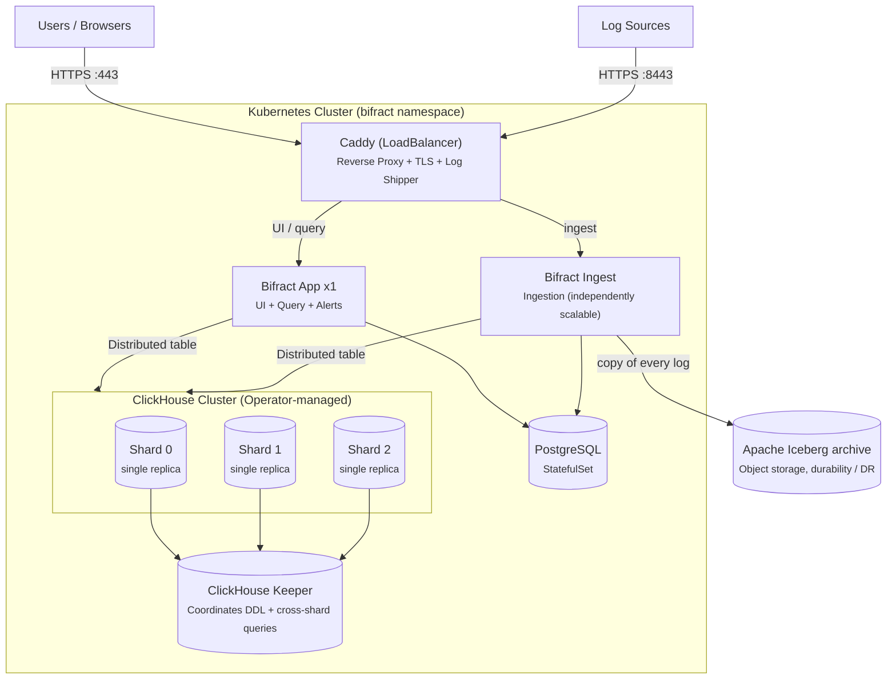

# Kubernetes Deployment

Deploy Bifract to a Kubernetes cluster (EKS, AKS, GKE and similar) when you need more than one node for ClickHouse. `bifract --install-k8s` generates Kustomize manifests with secure credentials; you apply them with `kubectl`. For a single host, [Docker Compose](installation.md) is simpler.

## Prerequisites

- Kubernetes 1.28 or later, with `kubectl` connected to it
- `helm` 3
- A domain name you can point at a load balancer

## Architecture



ClickHouse is sharded for throughput but not replicated: each shard is one replica. Durability comes from the [Iceberg archive](../administration/backup-restore.md#iceberg-archive), which receives a copy of every log once enabled. Keeper is still needed for `ON CLUSTER` DDL and cross-shard queries.

## Deploy

1. Install cert-manager and wait for it:

    ```bash
    kubectl apply -f https://github.com/cert-manager/cert-manager/releases/download/v1.17.2/cert-manager.yaml
    kubectl -n cert-manager wait --for=condition=ready pod -l app.kubernetes.io/instance=cert-manager --timeout=120s
    ```

2. Install the [ClickHouse operator](https://clickhouse.com/docs/clickhouse-operator/overview) and check its pod is running:

    ```bash
    helm install clickhouse-operator -n clickhouse-operator-system --create-namespace \
      oci://ghcr.io/clickhouse/clickhouse-operator-helm
    kubectl -n clickhouse-operator-system get pods
    ```

    Skip steps 1 and 2 if you choose an external ClickHouse or ClickHouse Cloud in the wizard.

3. Generate the manifests:

    ```bash
    bifract --install-k8s
    ```

    | Step | Options |
    |---|---|
    | Domain | For example `bifract.example.com` |
    | SSL | **Let's Encrypt (automatic)** or **Custom certificate** |
    | IP access | **Allow all traffic**, **Restrict UI only (allow ingest)**, **Restrict all traffic** or **mTLS (mutual TLS for UI)** |
    | Resources | Size profile, **Dev** to **X-Large**. See the [Sizing Guide](sizing.md). |
    | ClickHouse | **Bundled (recommended)**, **External ClickHouse** or **ClickHouse Cloud** |
    | Shards, storage | Bundled only. Shards default to the profile's value; storage per shard defaults to 100 GB. |
    | Output | Manifest directory, default `./bifract-k8s` |

    Save the admin password from the summary; it is not shown again. To skip the wizard, see [Non-interactive Install](non-interactive.md).

4. Apply the manifests and watch the pods start:

    ```bash
    kubectl apply -k ./bifract-k8s
    kubectl -n bifract get pods -w
    ```

    Expect PostgreSQL, ClickHouse Keeper, one ClickHouse pod per shard, the Bifract app, Bifract ingest, the archive maintainer, and Caddy (with a log shipper sidecar). ClickHouse pods can take a minute while the operator creates them.

5. Get Caddy's external IP and create a DNS A record for your domain pointing at it:

    ```bash
    kubectl -n bifract get svc caddy
    ```

    Once DNS resolves, Caddy obtains a Let's Encrypt certificate. Sign in at `https://bifract.example.com` as `admin`.

!!! note "The app tier runs one replica"
    The app pod mounts the MaxMind PVC, which is `ReadWriteOnce`, so `replicas` stays at 1 with the `Recreate` strategy. Scale the ingest StatefulSet for ingest volume instead. To run more app replicas, first move the MaxMind PVC to an RWX storage class (Azure Files, EFS, NFS).

## Verify

```bash
curl https://bifract.example.com/api/v1/health
kubectl -n bifract logs -l app=bifract --tail=50
kubectl -n bifract exec -it bifract-ch-clickhouse-0-0-0 -- \
  clickhouse-client --query "SELECT * FROM system.clusters"
kubectl -n bifract get networkpolicies
```

## Post-deploy configuration

Optional features read their settings from the `bifract-secrets` Secret, which ships with empty placeholders. Fill in the keys, then restart the workloads that use them.

```bash
kubectl -n bifract edit secret bifract-secrets
kubectl -n bifract rollout restart deployment bifract
```

| Feature | Secret keys | Restart |
|---|---|---|
| [OIDC / SSO](../administration/oidc-sso.md) | `OIDC_ISSUER_URL`, `OIDC_CLIENT_ID`, `OIDC_CLIENT_SECRET`, `OIDC_REDIRECT_URL`, `OIDC_SCOPES`, `OIDC_DEFAULT_ROLE`, `OIDC_ALLOWED_DOMAINS`, `OIDC_BUTTON_TEXT` | `deployment bifract` |
| [Backups](../administration/backup-restore.md) | `S3_ENDPOINT`, `S3_BUCKET`, `S3_ACCESS_KEY`, `S3_SECRET_KEY`, `S3_REGION` | `deployment bifract` |
| [Iceberg archive](../administration/backup-restore.md#iceberg-archive) | `ARCHIVE_ENABLED`, `ARCHIVE_BACKEND`, `ARCHIVE_PREFIX`, `ARCHIVE_S3_*` or `ARCHIVE_AZURE_*` | `deployment bifract`, `statefulset bifract-ingest`, `deployment bifract-archive-maintain` |
| [GeoIP enrichment](../bql/field-operations.md) | `MAXMIND_LICENSE_KEY`, `MAXMIND_ACCOUNT_ID` | `deployment bifract` |
| [AI Chat](../features/ai-chat.md) | `LLM_PROVIDER`, `LLM_API_KEY`, `LLM_MODEL`, `LLM_BASE_URL` | `deployment bifract` |

`--upgrade-k8s` and `--reconfigure-k8s` copy values you set with `kubectl edit` back into the manifests, as long as `kubectl` can reach the cluster when you run them.

## Scale ClickHouse

Change the shard count at any time. Each shard adds one ClickHouse pod; writes and queries are spread across all shards.

```bash
bifract --reconfigure-k8s --dir ./bifract-k8s --shards 3
kubectl apply -k ./bifract-k8s
```

## Upgrade

```bash
bifract --upgrade-k8s --dir ./bifract-k8s
kubectl apply -k ./bifract-k8s
```

`--upgrade-k8s` checks the new image exists, backs up the manifests to `.backups/<timestamp>/`, and re-renders them with the new version. Secrets, size profile and settings are kept; PVCs and data are not touched. Add `--size <profile>` to change the size profile in the same step.

!!! warning "ClickHouse cannot be downgraded"
    When a release moves to a newer ClickHouse, the operator restarts ClickHouse and Keeper on the new image. Do not apply manifests from `.backups/` that predate that release: an older ClickHouse cannot read data the newer one wrote. See [Rolling back after a ClickHouse upgrade](../administration/backup-restore.md#rolling-back-after-a-clickhouse-upgrade).

## Reconfigure

`--reconfigure-k8s` re-renders the manifests without changing version, keeping secrets. Run it with no flags to pick up template changes from a newer `bifract` binary, or with overrides:

```bash
bifract --reconfigure-k8s --dir ./bifract-k8s --ip-access restrict-app --allowed-ips "10.0.0.0/8,192.168.1.0/24"
kubectl apply -k ./bifract-k8s
```

| Flag | Values |
|---|---|
| `--ip-access` | `all`, `restrict-app`, `restrict-all`, `mtls-app` (generates a client CA) |
| `--allowed-ips` | Comma-separated IPs or CIDRs |
| `--domain` | New domain, for example `new.example.com` |
| `--size` | `dev`, `x-small`, `small`, `medium`, `large`, `x-large` (also resets shards to the profile's value) |
| `--shards` | ClickHouse shard count, 1 or more |

A backup is written to `.backups/` before any change.

## Troubleshooting

| Symptom | Fix |
|---|---|
| Bifract pods crash-loop right after deploy | Usually PostgreSQL or ClickHouse is still starting; the pods recover on their own. Check `kubectl -n bifract logs <pod>`. |
| No Let's Encrypt certificate | Check DNS points at the load balancer and ports 80 and 443 are reachable. Read `kubectl -n bifract logs -l app=caddy`. If Caddy tried before DNS was ready, restart it: `kubectl -n bifract rollout restart deployment caddy`. |
