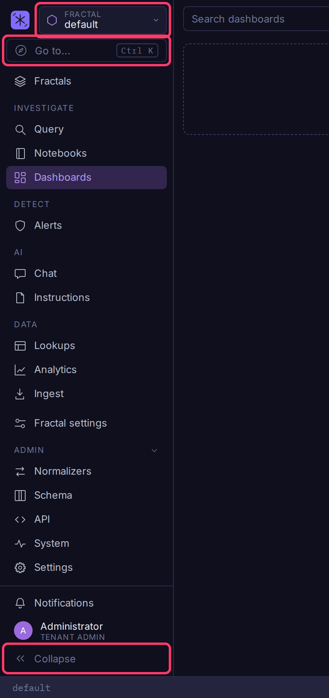
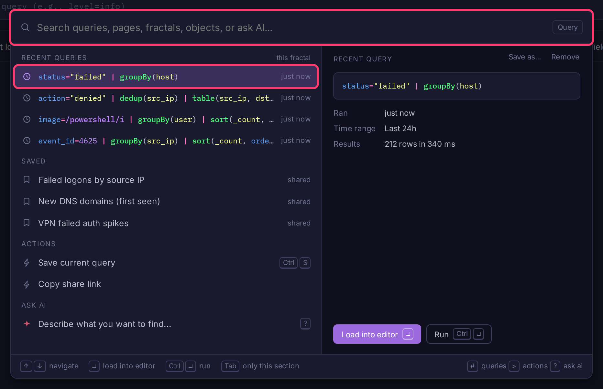

# Navigating Bifract

Every page is in the left sidebar. The selector at its top shows the fractal or prism you are working in, and the pages below it are scoped to that selection.

## Sidebar

| Section | Pages |
|---------|-------|
| Top | **Fractals**: every fractal and prism you can open |
| Investigate | **Query**, **Recall** (experimental, only when the archive is enabled), **Notebooks**, **Dashboards** |
| Detect | **Alerts** |
| AI | **Chat**, **Instructions** |
| Data | **Lookups**, **Analytics**, **Ingest** |
| Bottom | **Fractal settings** (fractal admins; **Prism settings** in a prism), then **Admin**: **Normalizers**, **Schema**, **API**, **System**, **Settings** (tenant admins) |

- **Switch scope**: use the selector at the top of the sidebar, or the chip at the left of the Query and Recall bars. A prism hides the pages that only exist for a fractal (Recall, Analytics, Ingest).
- **Collapse**: **Collapse** at the bottom folds the sidebar to icons; hover an icon for its name. Query and Recall start collapsed and other pages expanded, and each remembers your choice. Windows narrower than 900px show icons only; on a phone, open the sidebar from the menu button.
- **Open in a new tab**: every page and sub-page has its own URL. Ctrl-click, Cmd-click or middle-click a sidebar item.

## Command palette

Press Cmd+K (macOS) or Ctrl+K on any page, or click **Go to...** at the top of the sidebar. Type part of a name, then press Enter or click a result. The right side previews the highlighted result and its actions.

It finds:

- any page or sub-page, such as **Alerts > Coverage** or **Settings > Users**
- another fractal or prism
- a dashboard, notebook, alert rule, lookup or analytics model in the current scope
- your recent queries in this fractal, and its saved queries

The page you are on leads. On Query, your recent and saved queries come first, then actions such as **Save current query**. On Recall, **New search**, **Restore this window** and your recent recalls come first.

| Key | Does |
|-----|------|
| Enter | Open the result. On a query, load it into the editor |
| Cmd/Ctrl+Enter | Run a query |
| Tab | Show only the highlighted result's section, then move to the preview's buttons |
| `#`, `>`, `?` typed first | Show only queries, actions, or Ask AI |
| Backspace in an empty box | Show every section again |
| Cmd/Ctrl+S | On Query, save the query in the editor |
| Esc | Close a form, then the palette |

The **Recent** button on Recall opens the palette on its rows.

### Browse your queries

The **Queries** button on Query opens your queries to browse rather than search: **Saved** first, then **Recent**, one list at a time, each row showing the name, description, query and tags with its actions beside it (Load, Run, Edit, Favorite, Delete; Save as and Remove on recent ones). Tab switches lists, typing filters the one you are on, and Backspace in the empty box goes back to the full palette.

## Ask AI

When AI is configured, type `?` in the palette, or pick **Ask AI**, and describe what you want to find, for example `failed logins by source IP`. The AI reads the fractal's fields, writes a BQL query, and the server checks it before you see it.

The query is shown as a diff against the one in your editor, so you can ask for a change ("only the last hour", "add a count by host") and see exactly what moved. Enter loads it into the editor and Cmd/Ctrl+Enter runs it. Type a new request and press Enter to refine the answer. Nothing runs until you choose to.
