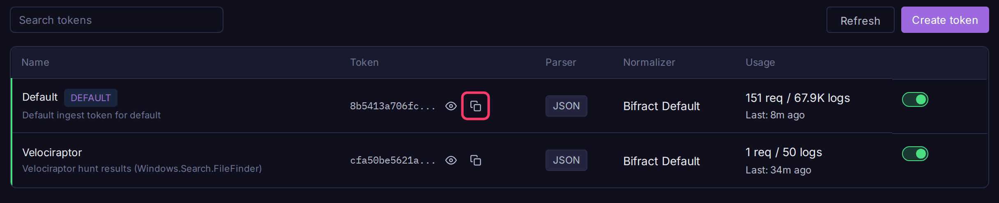
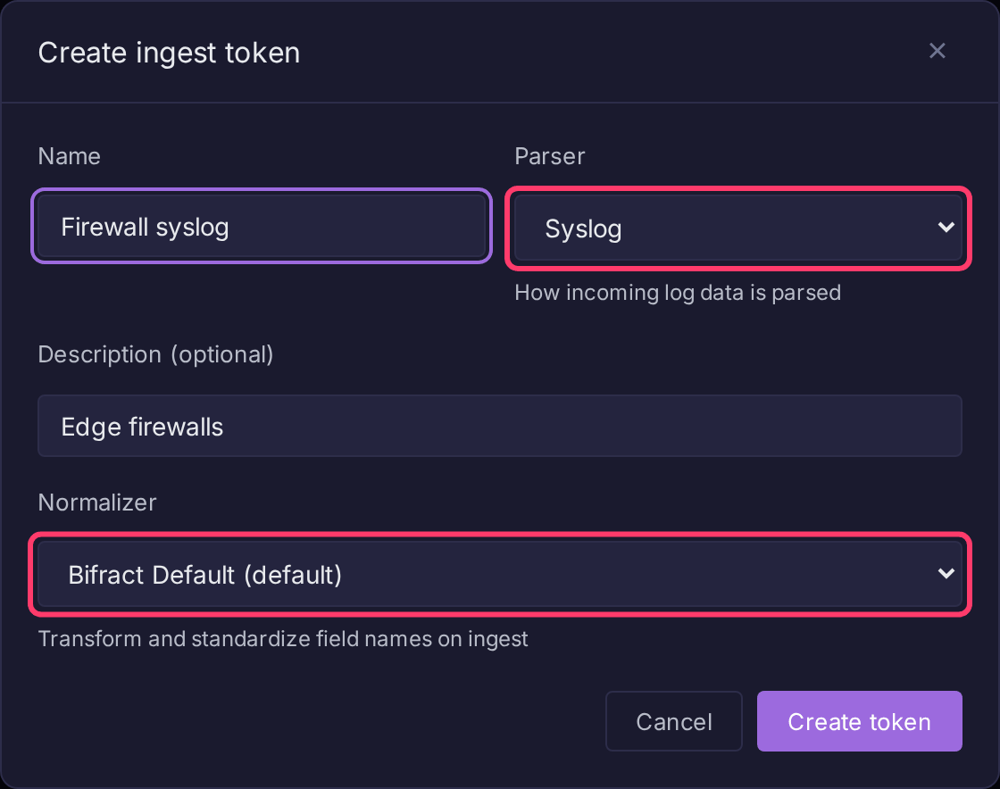

# Sending Logs

Send logs to Bifract over HTTP with an ingest token. Use this page to get a token and pick an endpoint; for the payload contract see [Log Ingestion](../api/ingestion.md), and for bulk file uploads see the [CLI tool](cli-tool.md).



## Get an ingest token

Every fractal gets a default token when it is created. Each token sends logs to exactly one fractal.

1. Open the fractal and click **Ingest** in the sidebar.
2. Click the copy icon (**Copy token**) in the **Token** column, or the eye icon to show it. Tokens start with `bifract_ingest_`.
3. Send it in the `Authorization` header:

```bash
curl -X POST https://bifract.example.com:8443/api/v1/ingest \
  -H "Authorization: Bearer $TOKEN" \
  -H "Content-Type: application/json" \
  -d '[{"event":"login","user":"admin"}]'
```

Caddy serves ingestion on port **8443** and refuses every other path there. A missing or wrong token returns `401`.

## Create a token for a new source

Give each log source its own token so it can be parsed, normalized and revoked separately.

1. On the **Ingest** page, click **Create token**.
2. Enter a **Name** and, optionally, a **Description**.
3. Pick a **Parser**: **JSON** (default), **Key=Value**, or **Syslog**.
4. Pick a **Normalizer**, or **None (no normalization)**. See [Normalizers](../features/normalizers.md).
5. Click **Create token**, then copy it from the **Token Created** panel.



Each row has a switch to disable the token, plus **Edit token** and **Delete token** icons. Changes apply at once on every app and ingest replica. The default token cannot be deleted.

## Endpoints

| Endpoint | Use for |
|---|---|
| `POST /api/v1/ingest` | JSON array, single JSON object, or NDJSON |
| `POST` or `PUT /_bulk` | Elasticsearch bulk clients (Velociraptor and similar) |
| `POST /v1/logs` | OpenTelemetry OTLP/HTTP, protobuf or JSON |
| `POST /services/collector/event`, `/raw` | Splunk HEC senders. See [Splunk HEC](splunk-hec.md) |

All take `Authorization: Bearer <token>` (`ApiKey <token>` and `Splunk <token>` also work) and accept `Content-Encoding: gzip`.

### NDJSON example

```bash
curl -X POST https://bifract.example.com:8443/api/v1/ingest \
  -H "Authorization: Bearer $TOKEN" \
  -H "Content-Type: application/json" \
  --data-binary @logs.ndjson
```

### OpenTelemetry Collector

Bifract accepts logs only, so add the exporter to a `logs` pipeline:

```yaml
exporters:
  otlphttp:
    endpoint: https://bifract.example.com:8443
    headers:
      Authorization: "Bearer bifract_ingest_..."

service:
  pipelines:
    logs:
      exporters: [otlphttp]
```

OTLP fields map as follows. The token's normalizer applies afterwards, as for other formats.

| OTLP field | Bifract field |
|---|---|
| `Body` | `message` |
| `SeverityText`, `SeverityNumber` | `severity_text`, `severity_number` |
| `TraceId`, `SpanId` | `trace_id`, `span_id` (hex) |
| `Flags` | `flags` |
| `Resource.Attributes` | `resource.` prefix (e.g. `resource.service.name`) |
| `Scope.Name`, `Scope.Version`, `Scope.Attributes` | `scope.name`, `scope.version`, `scope.` prefix |
| `Attributes` | Stored as-is (e.g. `http.method`) |
| `TimeUnixNano` | Event timestamp (falls back to `ObservedTimeUnixNano`) |

## Timestamps

Bifract takes the event time from the first match below, otherwise the ingest time:

1. Timestamp fields set on the token (API only: `timestamp_fields` on the token).
2. The **Timestamp Fields** of the token's normalizer.
3. Instance defaults: `system_time`, `timestamp`, `@timestamp`, `time`.
4. Auto-detected from `timestamp`, `@timestamp`, `time`, `ts`, `_time`.

Step 3 runs only when neither the token nor its normalizer defines timestamp fields. Auto-detection reads RFC 3339 and `2006-01-02 15:04:05` style strings, not epoch numbers. For Unix time, add a timestamp field with format `unix`, `unixmilli`, `unixmicro` or `unixnano` to the normalizer.

## Parse upstream

Bifract parses structured formats (JSON, key=value, syslog) and normalizes field names. It does not do grok patterns, multi-line assembly or other free-text extraction. Use Logstash, Cribl, Fluent Bit or Vector upstream for that, and send Bifract structured events. For CEF devices such as UniFi, see [CEF over Syslog with Vector](vector-cef.md).
